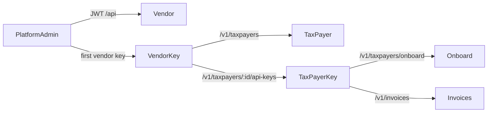
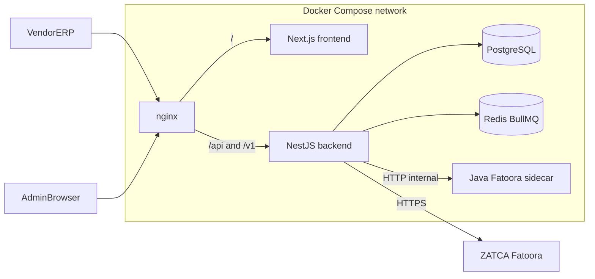
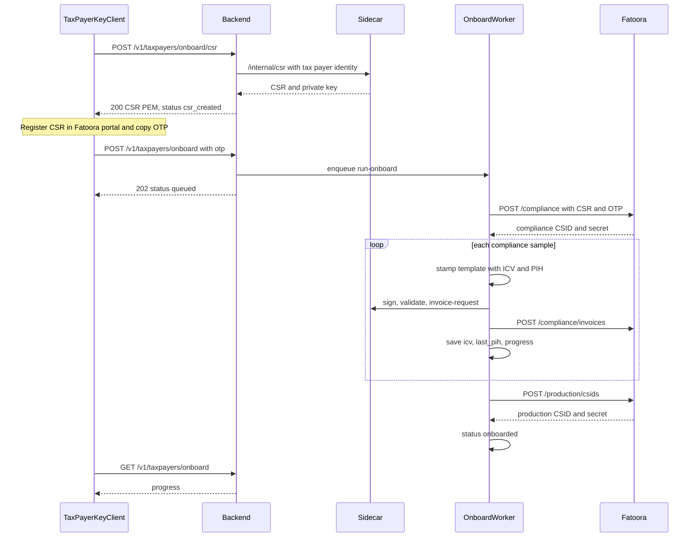
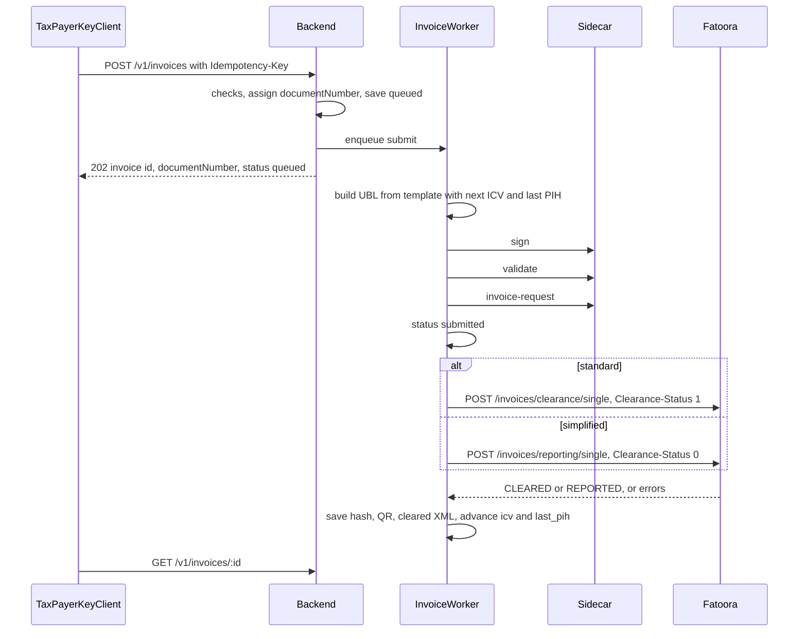
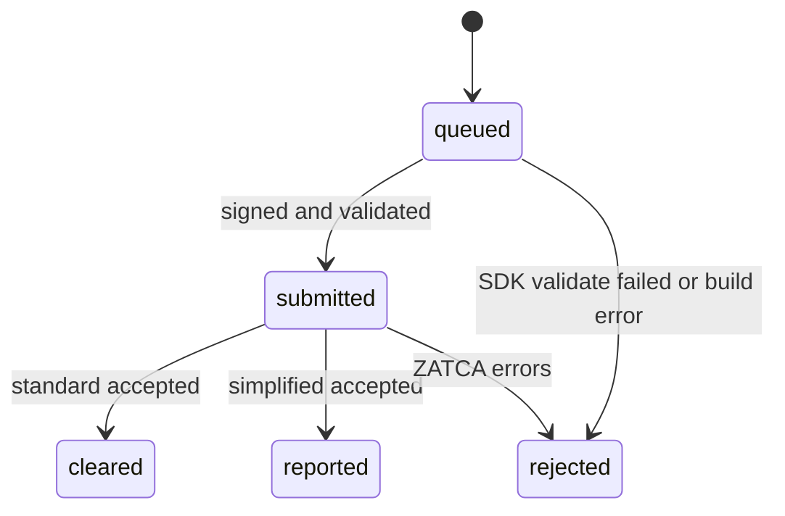
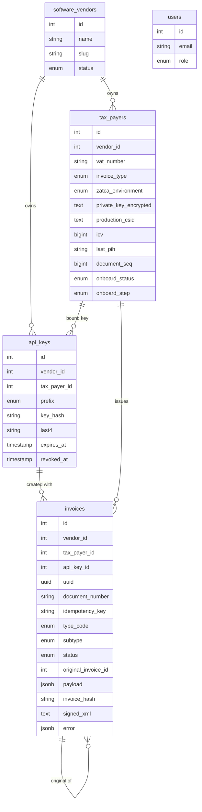

# ZATCA Gateway — architecture

This document explains what the gateway does, who calls it, how the services fit together, and how a tax payer moves from registration to cleared invoices. It describes the code as it runs today. The phase plans in [plan/](../plan/README.md) hold the design history and the roadmap.

## 1. What this app is

The ZATCA Gateway is a multi-tenant service that sits between vendor ERP systems and ZATCA's Fatoora e-invoicing platform in Saudi Arabia.

A software vendor (an ERP or POS company) signs up its customers, the tax payers. For each tax payer, the gateway:

1. Generates a key pair and CSR, and gets a compliance CSID from Fatoora with the OTP the tax payer copies from the Fatoora portal.
2. Signs and submits the compliance sample invoices that ZATCA requires, then exchanges the compliance CSID for a production CSID (PCSID).
3. Builds, signs, and validates live UBL invoices, then clears them (standard, B2B) or reports them (simplified, B2C) with Fatoora.

The vendor never handles certificates, XML signing, hash chains, or the Fatoora SDK. It sends JSON and polls for status.

## 2. Actors and keys

| Actor | Authenticates with | Routes |
| --- | --- | --- |
| Platform admin | JWT from `POST /api/auth/login` | `/api/vendors`, `/api/vendors/:vendorId/api-keys`, `/api/vendors/:vendorId/tax-payers`, `/api/users` |
| Vendor | Vendor API key (no tax payer on the key) | `/v1/api-keys`, `/v1/taxpayers`, `/v1/taxpayers/:id/api-keys`, `/v1/taxpayers/:id/onboard*` |
| Tax payer | Tax payer API key (bound to one tax payer) | `/v1/taxpayers/onboard/csr`, `/v1/taxpayers/onboard`, `/v1/taxpayers/renew`, `/v1/invoices` |

Both key types use the same format. The prefix picks the ZATCA environment:

| Prefix | ZATCA environment |
| --- | --- |
| `sk_sandbox_` | Developer portal (non-production SDK mode) |
| `sk_test_` | Simulation |
| `sk_live_` | Production |

The admin creates the vendor and its first vendor key. After that, the vendor creates tax payers and their keys on its own. A tax payer key cannot create keys or see another tax payer, even one that belongs to the same vendor.



## 3. System diagram



nginx is the only public entry point. It routes `/api/` and `/v1/` to the backend and everything else to the frontend ([deployment/nginx.conf](../deployment/nginx.conf)). The backend container only exposes port 8080 inside the network. The sidecar runs the Fatoora SDK and must stay internal. nginx never routes to it.

## 4. Containers and responsibilities

All services are defined in [deployment/docker-compose.yml](../deployment/docker-compose.yml). Settings come from `deployment/.env` (template: [deployment/.env.example](../deployment/.env.example)).

**nginx** (`nginx:1.27-alpine`) listens on `NGINX_PORT` (default 80) and proxies to `backend:8080` and `frontend:3000`.

**backend** (NestJS, [backend/](../backend/)) holds the public API, authentication, the database, the Fatoora HTTP client, and the BullMQ workers for onboarding and invoices. It runs TypeORM migrations on boot (`DATABASE_MIGRATIONS_RUN=true`). Key settings:

| Variable | Purpose |
| --- | --- |
| `APP_SECRET_KEY` | AES-256-GCM key material for private keys and CSIDs at rest |
| `API_KEY_HASH_SECRET` | HMAC secret for API key hashes |
| `SIDECAR_URL` | Sidecar base URL, `http://sidecar:8090` |
| `ZATCA_SIMULATION_BASE_URL`, `ZATCA_DEVELOPER_PORTAL_BASE_URL`, `ZATCA_PRODUCTION_BASE_URL` | Fatoora base URL for each environment |
| `REDIS_URL`, `BULL_PREFIX` | BullMQ connection and key prefix (`bull:docker` keeps compose workers apart from a host Nest process) |

**sidecar** (Java plus the Fatoora SDK, [sidecar/](../sidecar/README.md)) is the only place the `fatoora` CLI runs. It exposes `/internal/csr`, `/internal/sign`, `/internal/validate`, `/internal/hash`, and `/internal/invoice-request`. Each call runs in a temporary sandbox folder with its own `SDK_CONFIG`, and the folder is wiped afterward. `SIDECAR_MAX_CONCURRENT` caps parallel SDK runs.

**postgres** (16) is the system of record. **redis** (7) backs the BullMQ queues `onboard` and `invoice`.

**frontend** (Next.js 15, [frontend/](../frontend/README.md)) is the platform-admin dashboard. It has login, a home page, system owners (vendors), and tax payers, with Arabic and English via next-intl. It calls the backend through nginx using the admin JWT.

## 5. Backend module map

The root module is [backend/src/app/app.module.ts](../backend/src/app/app.module.ts). Feature modules live in `backend/src/app/modules/`.

| Module | What it owns |
| --- | --- |
| `auth` | `POST /api/auth/login`, JWT issue |
| `user` | `/api/users` CRUD for platform users (`ADMIN`, `USER`) |
| `vendor` | `/api/vendors` CRUD for software vendors |
| `api-key` | Admin `/api/vendors/:vendorId/api-keys`, vendor `/v1/api-keys`, key hashing and verification |
| `tax-payer` | Admin `/api/vendors/:vendorId/tax-payers`, vendor `/v1/taxpayers` CRUD, and `/v1/taxpayers/:id/api-keys` |
| `onboard` | CSR, onboard start and poll, PCSID renew; the `onboard` BullMQ worker |
| `invoice` | `/v1/invoices` options, create, list, and get; the `invoice` BullMQ worker; UBL builder |
| `queue` | BullMQ connection and queue registration |
| `sidecar` | HTTP client for the Java sidecar |
| `zatca` | Fatoora HTTP client (`ZatcaClientFactory`) for onboarding and invoice endpoints |

Shared pieces live in `backend/src/core/`: enums, the error filter (`{ "error": { "type", "code", "message", "zatca_code" } }`), security guards and decorators, and encryption helpers. Migrations are in `backend/src/database/migrations/`.

## 6. Security model

**Admin JWT.** `AuthGuard` plus `RolesGuard` protect `/api/...` routes, and only `ADMIN` passes.

**API keys.** [api-key-or-jwt.guard.ts](../backend/src/core/security/guards/api-key-or-jwt.guard.ts) accepts either a JWT or a key starting with `sk_sandbox_`, `sk_test_`, or `sk_live_`. Keys are stored as HMAC-SHA256 hashes using `API_KEY_HASH_SECRET` ([api-key-util.ts](../backend/src/core/security/api-key-util.ts)). The plaintext appears only in the create response. Revoked and expired keys get 401. On success the guard puts the vendor, the key row, and the environment derived from the prefix on the request.

**Scoping.** Helpers in [require-api-key-vendor.ts](../backend/src/app/modules/tax-payer/require-api-key-vendor.ts) enforce who can call what:

- `requireApiKeyVendor`: `/v1` routes need a vendor API key (403 `api_key_required`).
- `requireVendorWideKey`: key management needs a vendor key, so a tax payer key gets 403 `vendor_key_required`.
- `requireTaxPayerKey`: tax payer onboard and invoices need a key bound to a tax payer (403 `taxpayer_key_required`).

Every query also filters by vendor id, and by tax payer id where it applies. A resource that belongs to another tenant returns 404. When a tax payer key is created, its prefix must match that tax payer's ZATCA environment (400 `api_key_taxpayer_environment`).

**Secrets at rest.** The tax payer's private key, compliance CSID and secret, and production CSID and secret are encrypted with AES-256-GCM using a key derived from `APP_SECRET_KEY` ([encrypt-util.ts](../backend/src/core/security/encrypt-util.ts)). Progress and invoice responses never return them, and they never return the OTP. The onboard worker blanks the OTP in the job data once the job is done.

## 7. Onboard flow

A tax payer onboards with its own key. No id appears in the path. The vendor key can run the same steps at `/v1/taxpayers/:id/...`.



Details:

- The CSR identity comes from the tax payer row ([csr-builder.ts](../backend/src/app/modules/onboard/csr-builder.ts)). Creating a new CSR clears any earlier CSIDs and compliance progress, because the new key pair invalidates them.
- Compliance samples are the unsigned templates in `backend/assets/zatca-templates/`. A tax payer with `invoice_type=both` runs six samples: invoice, credit, and debit for both standard and simplified. `standard` or `simplified` runs three. [sample-stamper.ts](../backend/src/app/modules/onboard/sample-stamper.ts) writes the seller, the ICV (KSA-16), and the previous invoice hash (KSA-13, PIH).
- The worker resumes from `onboard_compliance_done` when a run is retried.
- `POST .../renew` runs a new CSR, then the Fatoora `PATCH /production/csids` call with the OTP, then the samples, then a new PCSID.

Statuses: `idle`, `csr_created`, `queued`, `running`, `onboarded`, `failed`. Steps: `csr`, `csid`, `compliance`, `pcsid`, `done`. Errors are stored in `onboard_error` and returned on poll, including the Fatoora response body when there is one.

## 8. Invoice flow



What the API checks before it queues an invoice ([invoice.service.ts](../backend/src/app/modules/invoice/invoice.service.ts)):

- An `Idempotency-Key` header is present. A repeat with the same key and tax payer returns the existing invoice without using a new document number.
- The tax payer is onboarded, has a PCSID, and has a seller address.
- The subtype is allowed by the tax payer's `invoice_type`. Standard invoices need a buyer.
- Credit, debit, and return need `originalInvoiceId` (same tax payer) and `instructionNote`.
- Zero rated, exempt, and out of scope lines, discounts, and charges need an exemption code and reason.

The gateway assigns `documentNumber` as `{vatNumber}-{sequence}` from `tax_payers.document_seq`, for example `399999999900003-000001`.

The worker ([invoice.processor.ts](../backend/src/app/modules/invoice/invoice.processor.ts)) builds the XML with [invoice-builder.ts](../backend/src/app/modules/invoice/invoice-builder.ts). It reuses the six templates and fills in seller, buyer, lines, totals, line and document allowances, document charges, payment means, and the billing reference. The tax payer's ICV and last PIH move forward only when ZATCA accepts the invoice. A rejection leaves the hash chain as it was.



The status enum also has `received`, `signed`, and `failed`. The current worker does not set them.

## 9. Domain choices

The API accepts readable words, and [invoice-choices.ts](../backend/src/app/modules/invoice/invoice-choices.ts) maps them to the codes written into the XML. For example, `bank_card` becomes payment means `48`, `labelling` becomes charge reason `LA`, `commercial_registration` becomes buyer scheme `CRN`, and `zero_rated` becomes tax category `Z`. `GET /v1/invoices/options` returns each choice as a `value` and a `label` for frontend dropdowns.

There are six document types: standard and simplified, each as an invoice (388), credit note (381), or debit note (383). `return` is accepted as an alias of credit. The full request body, enums, and error codes are in [plan/phase-four-api.md](../plan/phase-four-api.md).

## 10. Data model



Notes:

- `api_keys.tax_payer_id` is empty for vendor keys and set for tax payer keys.
- `tax_payers` also stores the CSR, compliance CSID fields, address fields, and onboard progress and error.
- `invoices` keeps the request payload, unsigned, signed, and cleared XML, the QR, and the raw Fatoora request and response, so a rejection can be diagnosed later.
- Idempotency is unique on `(tax_payer_id, idempotency_key)`.
- All tables share base columns (`created_at`, `updated_at`, `deleted_at`, and the matching `*_by`). Deletes are soft.

## 11. ZATCA environments

| Environment | Key prefix | Fatoora base | SDK flag |
| --- | --- | --- | --- |
| `simulation` | `sk_test_` | `.../e-invoicing/simulation` | `-sim` |
| `developer_portal` | `sk_sandbox_` | `.../e-invoicing/developer-portal` | `-nonprod` |
| `production` | `sk_live_` | `.../e-invoicing/core` | none |

[zatca-client.ts](../backend/src/app/modules/zatca/zatca-client.ts) picks the base URL from the tax payer's environment. It sends `Accept-Version: V2` and HTTP Basic auth built from the CSID token and secret. Fatoora errors are turned into the gateway error envelope with `zatca_code` filled in.

Fatoora returns `binarySecurityToken` as base64 of the base64 certificate (it starts with `TUlJ...`). Basic auth uses the token exactly as returned. The SDK needs the inner certificate (`MII...`), so the sidecar's `normalizeCsidForSdk` unwraps it before it writes `cert.pem` for signing.

## 12. Run, test, and explore

Start the stack:

```bash
cd deployment
cp .env.example .env
docker compose up --build
```

Rebuild only the backend after code changes:

```bash
docker compose up -d --build --no-deps backend
```

Backend tests:

```bash
cd backend
pnpm test
pnpm exec tsc -p tsconfig.build.json --noEmit
```

Postman: import [postman/ZATCA-Gateway.postman_collection.json](../postman/ZATCA-Gateway.postman_collection.json) and the local environment. Run the folders in this order:

1. **1. Auth**: admin login
2. **2. Vendors (ADMIN)**: create a vendor
3. **3. API Keys (ADMIN)**: create the first `vendor_api_key`
4. **4b. Tax payers (vendor key)**: create a tax payer, then its `taxpayer_api_key`
5. **5b. Onboard (tax payer key)**: CSR, OTP, poll
6. **7. Standard invoices** or **8. Simplified invoices**

Folder **3b** manages vendor keys with the vendor key. More detail is in [postman/README.md](../postman/README.md).

## 13. Known limits and next steps

- **Out of scope today:** KSA-2 subtypes other than plain standard and simplified, prepayment (386), export, self-billing, third-party, summary, nominal, B2G, and non-SAR currencies.
- **Concurrency:** two invoices for the same tax payer can be processed at the same time. Both read the same ICV and PIH, and only one can extend the chain correctly. Processing one invoice at a time per tax payer, or holding a lock across the Fatoora call, would close this.
- **Errors:** when the invoice worker catches an exception, it stores `error.message` as a JSON string (the same format as `onboard_error`) and not a short human message.
- **Swagger:** controllers have OpenAPI decorators, but no Swagger UI is mounted yet.
- **Phase 5:** webhooks, rate limits, audit log, key rotation, and the admin dashboard pages for invoices. See [plan/phase-five.md](../plan/phase-five.md).

## Related docs

- Roadmap: [plan/README.md](../plan/README.md)
- Invoice API contract: [plan/phase-four-api.md](../plan/phase-four-api.md)
- Onboard design: [plan/phase-three.md](../plan/phase-three.md)
- Product overview: [sdk/ZATCA-SAAS-GATEWAY.md](../sdk/ZATCA-SAAS-GATEWAY.md)
- SDK study: [sdk/ZATCA-SDK-STUDY.md](../sdk/ZATCA-SDK-STUDY.md)
- Fatoora swagger: [sdk/fatoora-swagger/](../sdk/fatoora-swagger/)
