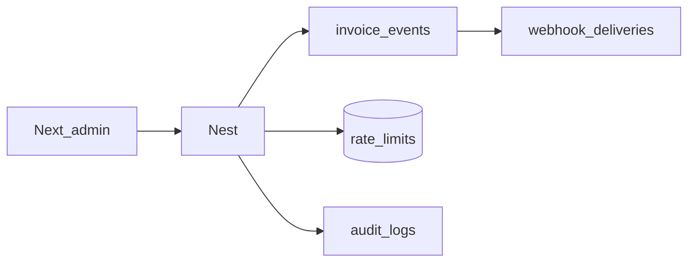

# Phase 5 — Harden (webhooks, limits, audit, dashboard)

**Depends on:** [phase-four.md](phase-four.md).  
**Delivers:** Product hardening left from the SaaS checklist.  
**Next:** production ops (outside this roadmap).

SDK isolation (sandbox, env, concurrent payers) lives in [phase-three.md](phase-three.md) — not here.

## This phase

- Outbound **webhooks** (invoice cleared / reported / rejected)
- **Rate limit** per API key (Redis)
- **Audit log** (admin user or API key)
- **Key rotation** (create new + revoke old)
- **Admin Next.js** dashboard (`frontend/`) — not vendor self-signup
- Sidecar remains network-internal only

---

## Webhooks

Tables (add to ERD / migrations):

### `webhook_endpoints`

| Attribute | Notes |
| --- | --- |
| `vendor_id` | FK |
| `url` | HTTPS |
| `secret` | For HMAC signature |
| `events` | jsonb array, e.g. `["invoice.cleared","invoice.reported","invoice.rejected"]` |
| `status` | `active` \| `disabled` |

### `webhook_deliveries`

| Attribute | Notes |
| --- | --- |
| `endpoint_id` | FK |
| `event_type` | |
| `payload` | jsonb |
| `response_status` | |
| `attempts` | |
| `next_retry_at` | |
| `delivered_at` | |

Admin APIs (JWT):

- `POST /api/vendors/:id/webhook-endpoints`
- `GET /api/vendors/:id/webhook-endpoints`
- `DELETE /api/vendors/:id/webhook-endpoints/:endpointId`
- `GET /api/vendors/:id/webhook-deliveries` (recent)

Vendor may also manage endpoints via `POST /v1/webhook_endpoints` later; v1 admin-only is enough.

Events fire after invoice worker reaches terminal status. Retries with backoff. Sign body with endpoint secret (HMAC). Do not include PEM / CSID in payloads.

---

## Rate limits

Redis, per API key (and optionally per IP for admin JWT):

- e.g. `N` requests / minute on `/v1/*`
- Invoice create may use a stricter bucket
- Return `429` with Stripe-like error envelope

Idempotency on invoice create already required (Phase 4).

---

## Audit log

### `audit_logs`

| Attribute | Notes |
| --- | --- |
| `vendor_id` | Nullable for platform-only actions |
| `actor_type` | `user` \| `api_key` |
| `actor_id` | |
| `action` | e.g. `vendor.create`, `api_key.revoke`, `invoice.create` |
| `entity_type` / `entity_id` | |
| `metadata` | jsonb — no secrets |
| `created_at` | |

Write on admin mutations and sensitive vendor API actions (key generate/revoke/rotate, onboard start, invoice create).

---

## Key rotation

Extend Phase 2 keys:

- `POST /api/vendors/:id/api-keys/:keyId/rotate` — generate new key (plaintext once), revoke old (or set grace `expires_at`)
- List shows rotated/revoked metadata; never re-show old secret

---

## Admin dashboard (Next.js)

Existing [`frontend/`](../frontend/). Platform admin only (JWT login already in backend).

Pages:

1. Login
2. Vendors — list / create / suspend
3. Systems & keys — create / revoke / rotate, test vs live, last used, expiry
4. Tax payers — identity CRUD, onboard status progress
5. Invoices — search, status, ZATCA errors, hash/QR (no private keys)
6. Developers — webhook URL, recent deliveries
7. Settings — vendor profile

UI should show onboard: `Draft → CSR created → Compliance → Samples → PCSID / onboarded`.

No vendor self-signup or vendor team invites in v1.

---

## Security checklist (close SaaS gaps)

- Hash API keys; encrypt CSID + private keys at rest
- Test keys never hit production Fatoora
- Rate limit per key; idempotency on invoice create
- Do not log PEM, OTP, or raw keys
- Sidecar internal-only (network policy)
- Java 11–14 only for the sidecar

---

## Out of scope

- Vendor portal for ERP customers
- Multi-EGS / `systems` table
- VAT groups, export / self-bill / prepayment
- RabbitMQ
- Changing the official JAR
