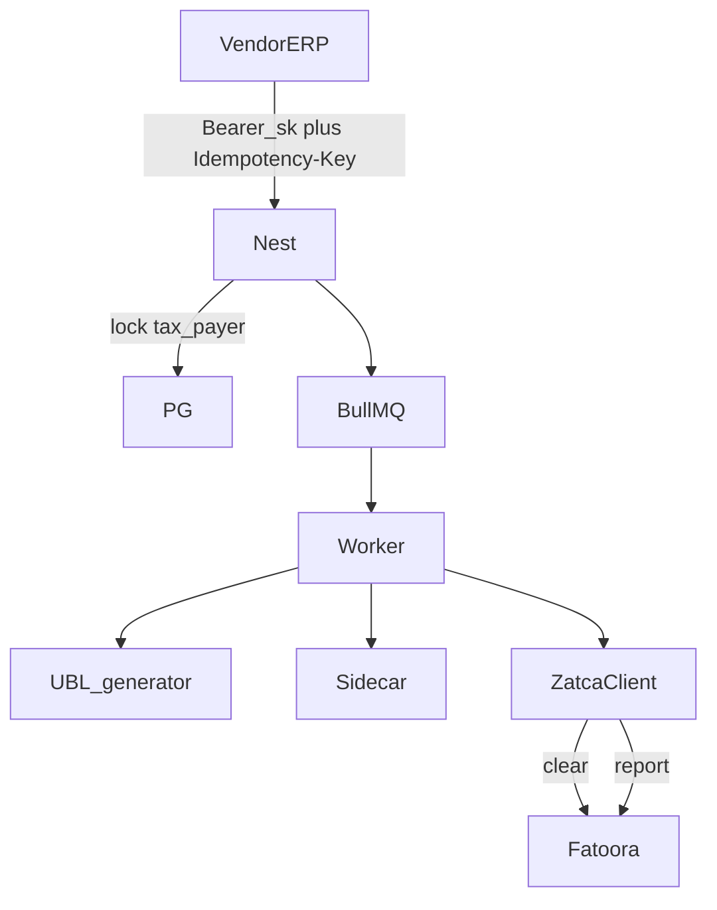

# Phase 4 — Live invoices

**Depends on:** [phase-three.md](phase-three.md) (`.env` + `ZatcaClient`, sidecar sandbox, onboarded PCSID).  
**Delivers:** UBL generator + `POST /v1/invoices` via `ZatcaClient.invoices.clear` / `report`.  
**Next:** [phase-five.md](phase-five.md) — Harden.

Build UBL 2.1 by **stamping** vendor JSON onto SDK sample XMLs (fixture-driven). Vendor sends **business data**; gateway sets seller/ICV/PIH/totals, sidecar signs + SDK `-validate`, then Fatoora through the same **ZatcaClient** as onboard (bases from Phase 3 `.env`). Contracts: [sdk/fatoora-swagger/](../sdk/fatoora-swagger/).

## This phase

- Invoice table + `POST /v1/invoices` (worker + poll)
- Fixture-driven generator for the **six** live document types (SDK samples as templates)
- Discounts, VAT %, credit/debit (returns), standard vs simplified
- Fatoora clearance / reporting via `ZatcaClient.invoices` (`Clearance-Status` headers)
- On reject: **do not** advance PIH; store signed + cleared XML when successful

**Not this phase:** export, self-billing, third-party, summary, nominal, B2G, prepayment `386`, non-SAR.



Auth: `Authorization: Bearer sk_test_...` / `sk_live_...`. Tax payer must be `onboarded` (PCSID). Seller address fields required. Test keys → simulation only. Header `Idempotency-Key` required. Env resolution: see [phase-three.md](phase-three.md) (`.env` + key prefix).

---

## Six document types

Same root `<Invoice>`. Type is code + KSA-2 `@name`.

| Kind | subtype | typeCode | KSA-2 | Fatoora | Buyer |
| --- | --- | --- | --- | --- | --- |
| Standard tax invoice | `standard` | `388` | `0100000` | clearance **before** customer gets it | **Mandatory** |
| Standard credit (return) | `standard` | `381` | `0100000` | clearance | Mandatory + `originalInvoiceId` + reason |
| Standard debit | `standard` | `383` | `0100000` | clearance | Mandatory + `originalInvoiceId` + reason |
| Simplified tax invoice | `simplified` | `388` | `0200000` | reporting within **24h** (BR-KSA-98) | Optional |
| Simplified credit (return) | `simplified` | `381` | `0200000` | reporting | Optional buyer; original + reason |
| Simplified debit | `simplified` | `383` | `0200000` | reporting | Optional buyer; original + reason |

Gated by tax payer `invoice_type` (`standard` / `simplified` / `both`). Mismatch → `400` (`taxpayer_invoice_type`).

**Return** = credit note (`381`) with `instructionNote` (dictionary **M** on 381/383, **NA** on 388).

---

## HTTP

| Method | Path | Notes |
| --- | --- | --- |
| `POST` | `/v1/invoices` | Header `Idempotency-Key`. **202**. Worker: XML → sign → validate → clearance/reporting |
| `GET` | `/v1/invoices/:id` | Status, hash, QR, ZATCA error. No private keys |
| `GET` | `/v1/invoices` | Filter by taxPayerId, status, subtype |

`jobId = invoice:{vendorId}:{idempotencyKey}`. `SELECT … FOR UPDATE` on `tax_payers` for ICV/PIH.

Statuses: `queued` → `signed` → `submitted` → `cleared` \| `reported` \| `rejected` \| `failed`.

---

## Payload (`POST /v1/invoices`)

Seller is **not** in the body — copied from the tax payer.

```json
{
  "taxPayerId": 12,
  "documentNumber": "INV-2026-0001",
  "subtype": "standard",
  "type": "invoice",
  "issueDate": "2026-09-19",
  "issueTime": "18:30:00",
  "currency": "SAR",
  "supplyDate": "2026-09-19",
  "paymentMeansCode": "10",
  "instructionNote": null,
  "originalInvoiceId": null,
  "buyer": {
    "name": "Fatoora Samples LTD",
    "vatNumber": "399999999800003",
    "idScheme": "CRN",
    "idValue": "1010010000",
    "streetName": "Salah Al-Din",
    "buildingNumber": "1111",
    "district": "Al-Murooj",
    "city": "Riyadh",
    "postalZone": "12222",
    "country": "SA"
  },
  "documentDiscount": {
    "amount": 10.00,
    "reason": "discount",
    "percent": 5,
    "baseAmount": 200.00,
    "taxCategory": "S",
    "taxPercent": 15
  },
  "lines": [
    {
      "id": "1",
      "name": "Book",
      "quantity": 2,
      "unitCode": "PCE",
      "unitPrice": 100.00,
      "discount": { "amount": 5.00, "percent": 5, "baseAmount": 100.00 },
      "taxCategory": "S",
      "taxPercent": 15
    }
  ]
}
```

`type`: `invoice` \| `credit` \| `debit` (388 / 381 / 383). `return` is an alias of `credit`.

Credit/debit required:

```json
{
  "type": "credit",
  "originalInvoiceId": 88,
  "instructionNote": "In case of goods or services refund | عند ترجيع السلع أو الخدمات"
}
```

| Category | Code | Percent | Exemption |
| --- | --- | --- | --- |
| Standard rated | `S` | 15 (typical) | none |
| Zero rated | `Z` | 0 | code + text **C** (e.g. `VATEX-SA-35`) |
| Exempt | `E` | 0 | e.g. `VATEX-SA-29-7` |
| Out of scope | `O` | 0 | `VATEX-SA-OOS` |

`ChargeIndicator` for allowances is always `false` (BR-KSA-F-02).

---

## Generator (fixture-driven)

Do **not** reinvent UBL from the dictionary spreadsheet. Stamp business data onto the six SDK sample structures under [`sdk/Data/Samples/`](../sdk/Data/Samples/).

1. Pick sample XML by subtype + type (standard/simplified × invoice/credit/debit)
2. Stamp seller from tax payer, buyer/lines/dates/discounts from vendor JSON, ICV + PIH from locked tax payer row
3. Gateway computes tax totals (group by category + percent); `PayableAmount` = inclusive − prepaid (v1 prepaid `0`); amounts 2 decimals; `ChargeIndicator` false for allowances
4. Credit/debit: `BillingReference` + `InstructionNote` + `originalInvoiceId` (same tax payer)
5. Output unsigned XML (no UBLExtensions / QR value) → sidecar `-sign` / `-validate` / `-invoiceRequest`

**When coding — fixture tests first:** golden unsigned XML per type → sidecar `-validate` PASS → then Fatoora. Local gate is SDK only (no Nest dictionary re-pass).

Stamp must keep: `ProfileID` `reporting:1.0`, UUID (KSA-1), ICV/PIH chain, type code + KSA-2 `@name`, seller VAT + address, UBL element order matching samples.

---

## Fatoora submit (`ZatcaClient`)

Reuse Phase 3 client and bases ([sdk/fatoora-swagger/](../sdk/fatoora-swagger/)). Do not hardcode URLs.

```ts
const client = ZatcaClient.create(taxPayer.zatca_environment);
// body from sidecar -invoiceRequest:
// { invoiceHash, uuid, invoice }
```

Shared: `Accept-Version: V2`, Basic **PCSID** (`production_csid` + `production_csid_secret`). Env must match `tax_payers.zatca_environment` and key prefix.

### `invoices.clear` (standard)

Source: [clearance.pdf](../sdk/fatoora-swagger/clearance.pdf).

- `POST {base}/invoices/clearance/single`
- Headers: **`Clearance-Status: 1`** (required; `0` = clearance disabled)
- Body: `{ invoiceHash, uuid, invoice }`
- **200:** `{ validationResults, clearanceStatus: "CLEARED", clearedInvoice: "<base64>" }` → decode/store `cleared_xml`
- Must clear **before** issuing to customer

### `invoices.report` (simplified)

Source: [reporting.pdf](../sdk/fatoora-swagger/reporting.pdf).

- `POST {base}/invoices/reporting/single`
- Headers: **`Clearance-Status: 0`** (required on reporting swagger)
- Body: same `{ invoiceHash, uuid, invoice }`
- **200 / 202:** `{ validationResults, reportingStatus: "REPORTED" }` (202 = accepted with warnings)
- Report within **24 hours** (BR-KSA-98)

| Subtype | Call |
| --- | --- |
| Standard | `client.invoices.clear(body)` |
| Simplified | `client.invoices.report(body)` |

Errors: Stripe-like `{ error: { type, code, message, zatca_code } }` from `validationResults.errorMessages`.

---

## Worker

1. Validate JSON + taxpayer type + original invoice + seller address present
2. Lock tax payer; assign UUID, ICV, PIH
3. Generate unsigned XML (no UBLExtensions, no QR value)
4. Sidecar sign / validate / invoice-request (sandbox)
5. `ZatcaClient.create(env)` → standard `clear()` / simplified `report()`
6. **On success:** save hash as next PIH; store `unsigned_xml`, `signed_xml`, `cleared_xml` (if any), QR; status `cleared` or `reported`
7. **On ZATCA reject or SDK NOT PASS:** do **not** advance PIH; status `rejected` / `failed`

---

## Schema

Create `invoices` from [phase-one.md](phase-one.md) (including `idempotency_key`, XML columns, `zatca_request` / `zatca_response`, `job_id`, `error`).

---

## Out of scope

- KSA-2 flags other than `01`/`02`
- Document-level charges (`ChargeIndicator` true)
- Invoice type `386` prepayment
- Dashboard UI, webhooks (Phase 5)
- RabbitMQ
