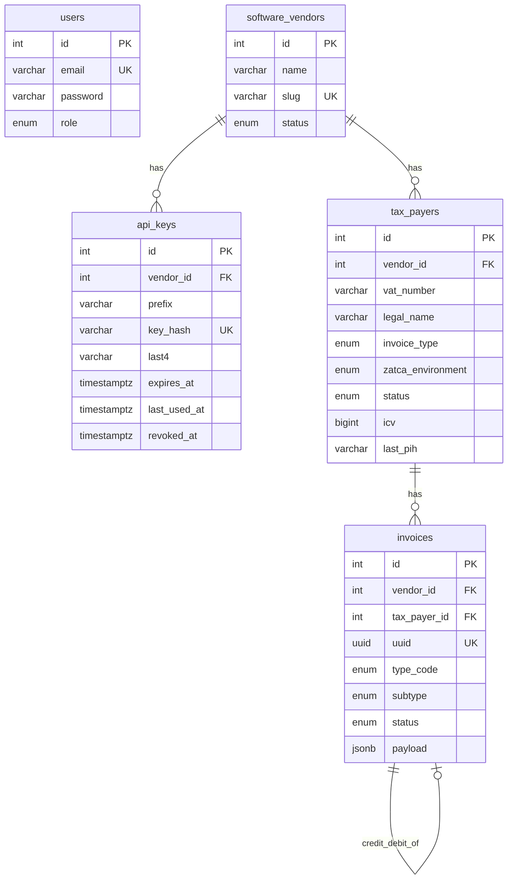

# Phase 1 — Backend ERD

**Depends on:** [phase-zero.md](phase-zero.md) (compose topology; optional if developing schema-only).  
**Delivers:** Postgres tables and columns for the whole product.  
**Next:** [phase-two.md](phase-two.md) — Admin APIs + migrations.

No TypeORM entities or migrations in this phase — this file is the single column source of truth.

## Who does what

- Platform **admin** creates software vendors and manages tax payers, invoices, and API keys.
- Vendors do **not** sign up or log in.
- Admin generates **API keys** on the vendor; later the vendor ERP calls `/v1` with those keys.

## Model

- Vendor and software are one tenant (`software_vendors`).
- One tax payer = one EGS in v1 (CSR / CSID / ICV / PIH on `tax_payers`).
- Invoices belong to the tax payer.
- `users` are platform operators only — not linked to vendors.

Every table uses the existing TypeORM base from [`backend/src/core/utils/base.entity.ts`](../backend/src/core/utils/base.entity.ts): integer `id`, audit fields, soft delete.

## Base columns (all tables)

| Attribute | Type | Nullable | Notes |
| --- | --- | --- | --- |
| `id` | int | no | Primary key, auto increment |
| `created_by` | varchar | yes | |
| `created_at` | timestamptz | yes | Default `now()` |
| `updated_by` | varchar | yes | |
| `updated_at` | timestamptz | yes | |
| `deleted_by` | varchar | yes | Soft delete |
| `deleted_at` | timestamptz | yes | Soft delete |

---

## `users`

Platform operators. Existing table — keep as-is. No `vendor_id`. Role stays [`ADMIN` / `USER`](../backend/src/core/enums/user-role.ts).

| Attribute | Type | Nullable | Notes |
| --- | --- | --- | --- |
| `email` | varchar | no | Unique |
| `password` | varchar | no | Hashed |
| `username` | varchar | yes | |
| `activated` | boolean | no | Default `false` |
| `image_url` | varchar | yes | |
| `role` | enum | no | `ADMIN` \| `USER` |

---

## `software_vendors`

Tenant we add by hand: the ERP/POS company and their software.

| Attribute | Type | Nullable | Notes |
| --- | --- | --- | --- |
| `name` | varchar | no | Company / product name |
| `slug` | varchar | no | Unique |
| `status` | enum | no | `active` \| `suspended`. Default `active` |

---

## `api_keys`

Generated by admin. One key can reach all tax payers of that vendor.

| Attribute | Type | Nullable | Notes |
| --- | --- | --- | --- |
| `vendor_id` | int | no | FK → `software_vendors.id` |
| `prefix` | varchar | no | `sk_test_` or `sk_live_` |
| `key_hash` | varchar | no | Unique. SHA-256 of the full secret. Plaintext shown once |
| `last4` | varchar | no | Last four characters of the secret |
| `expires_at` | timestamptz | no | Required on generate. Key unusable after this time |
| `last_used_at` | timestamptz | yes | Updated when `sk_*` auth succeeds (Phase 2+) |
| `revoked_at` | timestamptz | yes | Set on revoke |

---

## `tax_payers`

Seller identity + SDK/onboard state. Unique `(vendor_id, vat_number)`.

### Identity (CSR form — [CSR-FORM.md](../sdk/CSR-FORM.md))

| Attribute | Type | Nullable | Notes |
| --- | --- | --- | --- |
| `vendor_id` | int | no | FK → `software_vendors.id` |
| `vat_number` | varchar(15) | no | KSA VAT: starts and ends with `3`, 11th digit `0` (no VAT groups) |
| `legal_name` | varchar | no | CSR `csr.organization.name` |
| `organization_unit_name` | varchar | no | Branch. CSR `csr.organization.unit.name` |
| `location_address` | varchar | no | Wasel code, e.g. `RRRD2929` (CSR only) |
| `industry_business_category` | varchar | no | CSR industry |
| `invoice_type` | enum | no | `both` \| `standard` \| `simplified`. Default `both` → CSR bitmap `1100` / `1000` / `0100` |
| `country` | varchar(2) | no | Always `SA` |
| `status` | enum | no | `draft` \| `onboarded` \| `suspended`. Default `draft` |
| `zatca_environment` | enum | yes | `simulation` \| `production`. Set at CSR time; later calls must match. Developer-portal deferred |

### Seller address (live UBL — dictionary **M**; Wasel is not enough)

| Attribute | Type | Nullable | Notes |
| --- | --- | --- | --- |
| `street_name` | varchar | yes | Required before live invoices (Phase 4) |
| `building_number` | varchar | yes | |
| `district` | varchar | yes | City subdivision |
| `city` | varchar | yes | |
| `postal_zone` | varchar | yes | |
| `seller_id_scheme` | varchar | yes | `CRN` \| `MOM` \| `MLS` \| `SAG` \| `OTH` \| `700`. Default `CRN` |
| `seller_id_value` | varchar | yes | Scheme value |

### SDK secrets and chain

| Attribute | Type | Nullable | Notes |
| --- | --- | --- | --- |
| `csr_config` | jsonb | yes | Snapshot of `csr.*` for the sidecar |
| `private_key_encrypted` | text | yes | EC secp256k1. Encrypted at rest |
| `csr_pem` | text | yes | |
| `compliance_request_id` | varchar | yes | From compliance CSID `requestID` (string). Needed for PCSID |
| `compliance_csid` | text | yes | Encrypted `binarySecurityToken` (compliance) |
| `compliance_csid_secret` | text | yes | Encrypted `secret` for compliance Basic auth |
| `production_csid` | text | yes | Encrypted `binarySecurityToken` (PCSID) |
| `production_csid_secret` | text | yes | Encrypted `secret` for production Basic auth |
| `icv` | bigint | no | Invoice counter. Default `0` |
| `last_pih` | varchar | yes | Previous invoice hash. First invoice uses [Data/PIH/pih.txt](../sdk/Data/PIH/pih.txt) |

### Onboard progress (Phase 3 worker)

| Attribute | Type | Nullable | Notes |
| --- | --- | --- | --- |
| `onboard_status` | enum | yes | `idle` \| `csr_created` \| `queued` \| `running` \| `onboarded` \| `failed` |
| `onboard_step` | enum | yes | `csr` \| `csid` \| `compliance` \| `pcsid` \| `done` |
| `onboard_progress` | int | yes | 0–100 |
| `onboard_compliance_done` | int | yes | How many samples succeeded (0–6) |
| `onboard_error` | text | yes | Safe ZATCA message, no PEM |
| `onboard_job_id` | varchar | yes | BullMQ job id |

---

## `invoices`

One document under a tax payer. `payload` holds lines, buyer, and amounts so UBL can be built without new columns per UBL node.

| Attribute | Type | Nullable | Notes |
| --- | --- | --- | --- |
| `vendor_id` | int | no | FK → `software_vendors.id` |
| `tax_payer_id` | int | no | FK → `tax_payers.id` |
| `api_key_id` | int | yes | FK → `api_keys.id` |
| `uuid` | uuid | no | Unique. ZATCA KSA-1 |
| `document_number` | varchar | no | Seller invoice number |
| `idempotency_key` | varchar | yes | Unique with `vendor_id` (Phase 4) |
| `type_code` | enum | no | `388` invoice, `381` credit, `383` debit |
| `subtype` | enum | no | `standard` \| `simplified` |
| `ksa2_name` | varchar | yes | e.g. `0100000` |
| `status` | enum | no | `received` \| `queued` \| `signed` \| `submitted` \| `cleared` \| `reported` \| `rejected` \| `failed`. Default `received` |
| `original_invoice_id` | int | yes | FK → `invoices.id`. Credit/debit only |
| `payload` | jsonb | no | Business JSON (lines, buyer, amounts) |
| `icv` | bigint | yes | Counter used on this document |
| `pih` | varchar | yes | Previous hash used |
| `invoice_hash` | varchar | yes | After sign |
| `qr_base64` | text | yes | After sign |
| `unsigned_xml` | text | yes | |
| `signed_xml` | text | yes | |
| `cleared_xml` | text | yes | After clearance |
| `zatca_request` | jsonb | yes | |
| `zatca_response` | jsonb | yes | |
| `job_id` | varchar | yes | BullMQ job id |
| `error` | jsonb | yes | Safe `{ type, code, message, zatca_code }` |

---

## Rules

- Tenant isolation: `api_keys`, `tax_payers`, and `invoices` all have `vendor_id`.
- Unique: `software_vendors.slug`, `users.email`, `api_keys.key_hash`, `(tax_payers.vendor_id, vat_number)`, `invoices.uuid`, `(invoices.vendor_id, idempotency_key)`.
- Secrets encrypted at rest; never store raw PEM in logs.

## Out of scope

- Vendor self-signup, vendor dashboard users
- Separate `systems` or `egs_devices` tables
- Webhooks / audit tables (Phase 5)
- VAT groups
- Migrations and Nest modules (Phase 2+)
