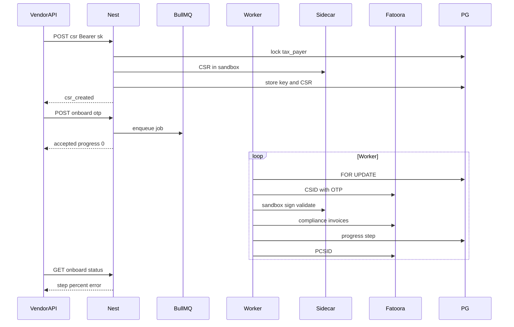

# Phase 3 — Sidecar + tax payer onboard

**Depends on:** [phase-two.md](phase-two.md).  
**Delivers:** Java sidecar with per-job sandbox; vendor `sk_*` onboard (CSR → OTP → CSID → 6 samples → PCSID).  
**Next:** [phase-four.md](phase-four.md) — Live invoices.

The official `fatoora` JAR is a **single-folder** toolkit ([defaults.json](../sdk/Configuration/defaults.json)). Onboard and every later sign need a **short-lived sandbox** per job — not a Phase 5 afterthought.

## This phase

- Java 11–14 sidecar (internal HTTP)
- Per-job sandbox (cert / key / PIH isolated per tax payer)
- Env from `ZATCA_ENV` + API key prefix
- Vendor API: CSR sync, onboard worker with OTP, progress poll
- Six SDK sample templates stamped with tax payer identity
- SDK `-validate` only (no Nest dictionary re-pass)



---

## Auth

`Authorization: Bearer sk_test_...` or `sk_live_...` (Phase 2 hashed keys).

- Key must belong to the tax payer’s vendor, not expired, not revoked
- Successful auth updates `last_used_at`
- Test keys → simulation Fatoora only; live keys → production only
- Platform admin JWT may call the same routes for support
- Do not log OTP, PEM, or CSID

---

## Environment

Sidecar does not guess env. Nest sends `environment` on every internal call. Set `tax_payers.zatca_environment` at CSR time; later calls must match.

| Gateway / key | CSR flag | Fatoora base |
| --- | --- | --- |
| `sk_test_` or `ZATCA_ENV=simulation` | `-sim` (`TSTZATCA-Code-Signing`) | `https://gw-fatoora.zatca.gov.sa/e-invoicing/simulation` |
| staging `ZATCA_ENV=developer` | `-nonprod` (`PREZATCA`) | `.../e-invoicing/developer-portal` |
| `sk_live_` and `ZATCA_ENV=production` | none (`ZATCA-Code-Signing`) | `.../e-invoicing/core` |

Hard rules: test key cannot hit production; live key cannot use `-sim`.

---

## Sidecar (sandbox)

Internal only. On Linux call `java -jar` (the `fatoora` script only forwards 6 args). Use absolute paths into shared XSD/Schematron; on Linux the folder is `Schematrons/` (case matters).

Endpoints:

- `POST /internal/csr`
- `POST /internal/sign`
- `POST /internal/validate`
- `POST /internal/hash`
- `POST /internal/invoice-request`

### Per-job sandbox

1. Create `tmp/sdk-job-{uuid}/`
2. Write `config.json`: XSD / Schematron / usage → shared SDK; `certPath` / `privateKeyPath` / `pihPath` / `inputPath` → sandbox
3. Decrypt tax payer private key + CSID into the files `fatoora` expects (no PEM headers for signing — [ZATCA-SDK-STUDY.md](../sdk/ZATCA-SDK-STUDY.md))
4. Write `pih.txt` from `tax_payers.last_pih` (first invoice uses [Data/PIH/pih.txt](../sdk/Data/PIH/pih.txt))
5. `SDK_CONFIG=<sandbox>/config.json` + `java -jar`
6. Return result; wipe sandbox. Never log PEM

Do **not** use dummy [`sdk/Data/Certificates`](../sdk/Data/Certificates) on real tax payer rows.

### Concurrent tax payers

| Case | What happens |
| --- | --- |
| Different payers, same second | Separate sandboxes, separate JVMs. Shared XSD read-only |
| Same payer, two jobs | Postgres `FOR UPDATE` on that row. Second waits. ICV/PIH stay one chain |
| Same vendor, many shops | Isolation is `tax_payer_id`, not the API key |

Cap with `SIDECAR_MAX_CONCURRENT` (e.g. 8–16). Extra jobs wait in BullMQ. No global mutex around `fatoora`.

### Internal request shape

```json
{
  "environment": "simulation",
  "operation": "sign",
  "privateKey": "<decrypted for this call only>",
  "csid": "<compliance or production cert>",
  "pih": "<last_pih>",
  "invoiceXml": "<unsigned ubl>"
}
```

### Validation (SDK only)

After `-sign`, run **`fatoora -validate`** in the same sandbox. No Nest dictionary re-pass.

- NOT PASS → return `BR-*` / `BR-KSA-*`, do not bump ICV/PIH, do not call Fatoora
- PASS → `-invoiceRequest` then Fatoora

---

## HTTP (vendor API)

| Method | Path | Mode | Notes |
| --- | --- | --- | --- |
| `POST` | `/v1/taxpayers/:id/onboard/csr` | Sync | Build `csr.*` from identity. Returns CSR PEM. Private key stored encrypted, never returned |
| `POST` | `/v1/taxpayers/:id/onboard` | Async | Body `{ "otp" }`. Enqueue worker. **202**. 409 if no CSR or job already running |
| `GET` | `/v1/taxpayers/:id/onboard` | Sync | Progress only. No OTP, key, CSR, or CSID |

CSR fields: [CSR-FORM.md](../sdk/CSR-FORM.md).

### Payload examples

Header: `Authorization: Bearer sk_test_...`

**Create CSR** — `POST /v1/taxpayers/12/onboard/csr` — body `{}`

```json
{
  "taxPayerId": 12,
  "status": "csr_created",
  "csr": "-----BEGIN CERTIFICATE REQUEST-----\nMIIB...\n-----END CERTIFICATE REQUEST-----",
  "commonName": "TST-3999999999-399999999900003",
  "serialNumber": "1-Antoor|2-Gateway|3-ed22f1d8-e6a2-1118-9b58-d9a8f11e445f"
}
```

Caller registers this CSR in Fatoora and copies the OTP. We do **not** generate OTP.

**Start onboard** — `POST /v1/taxpayers/12/onboard`

```json
{ "otp": "123456" }
```

Response `202`:

```json
{
  "taxPayerId": 12,
  "status": "queued",
  "step": "csid",
  "progress": 0,
  "complianceDone": 0,
  "complianceTotal": 6,
  "error": null
}
```

**Poll** — `GET /v1/taxpayers/12/onboard` — same shape; `status` moves `running` → `onboarded` or `failed`.

---

## Worker (BullMQ / Redis)

One job per tax payer: `jobId = onboard:{taxPayerId}`. OTP is passed into the job, used for CSID, then **dropped** (never in DB or logs).

Fatoora paths ([study](../sdk/ZATCA-SDK-STUDY.md)):

1. **csid** — `POST /compliance` with stored CSR + OTP. Basic auth from returned CSID. Store compliance CSID.
2. **compliance** — stamp each SDK sample; sidecar sign / validate / invoice-request; `POST /compliance/invoices`; bump ICV/PIH; increment `onboard_compliance_done`.
3. **pcsid** — `POST /production/csids`. Store production CSID. `onboard_status = onboarded`.

On failure: `failed`. Keep CSID if already saved. Commit ICV/PIH only after a successful sample. Retry: new OTP only if CSID was never issued; if CSID exists, resume remaining samples (no second CSR).

Progress columns: see [phase-one.md](phase-one.md). `complianceTotal` is 6 if `invoice_type` is `both`, else 3.

---

## Six templates

SDK examples (not dummy certs):

- [Standard_Invoice.xml](../sdk/Data/Samples/Standard/Invoice/Standard_Invoice.xml)
- [Standard_Credit_Note.xml](../sdk/Data/Samples/Standard/Credit/Standard_Credit_Note.xml)
- [Standard_Debit_Note.xml](../sdk/Data/Samples/Standard/Debit/Standard_Debit_Note.xml)
- [Simplified_Invoice.xml](../sdk/Data/Samples/Simplified/Invoice/Simplified_Invoice.xml)
- [Simplified_Credit_Note.xml](../sdk/Data/Samples/Simplified/Credit/Simplified_Credit_Note.xml)
- [Simplified_Debit_Note.xml](../sdk/Data/Samples/Simplified/Debit/Simplified_Debit_Note.xml)

Generator: strip `UBLExtensions` / signature / QR → overlay seller VAT + legal name → new UUID, issue date/time, ICV, PIH → sidecar sign. Keep sample lines, totals, buyer, and postal address.

---

## Out of scope

- Live `POST /v1/invoices` (Phase 4)
- Nest-side full dictionary re-validation
- RabbitMQ, dashboard wizard, vendor user login
- Storing SDK dummy `cert.pem` on `tax_payers`
