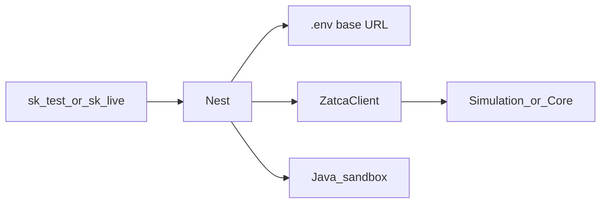
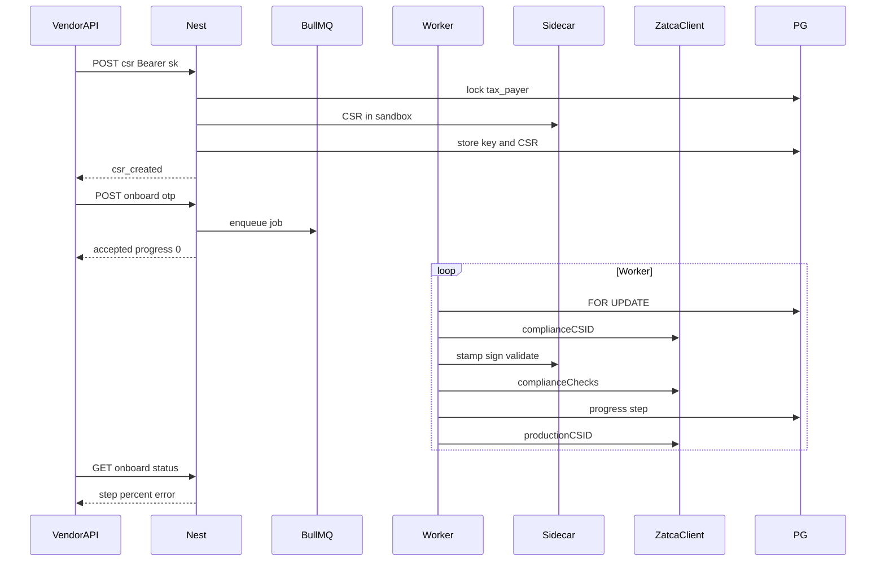

# Phase 3 — Sidecar + tax payer onboard

**Depends on:** [phase-two.md](phase-two.md).  
**Delivers:** Fatoora env + `ZatcaClient`; Java sidecar with per-job sandbox; vendor `sk_*` onboard (CSR → OTP → CSID → 6 samples → PCSID).  
**Next:** [phase-four.md](phase-four.md) — Live invoices (reuses `ZatcaClient.invoices`).



- **Nest** picks Simulation or Production from `.env` + API key.
- **ZatcaClient** = all Fatoora **HTTP** (onboard + invoices).
- **Sidecar** = local `fatoora` only (CSR / sign / validate / invoice-request). Never calls Fatoora.
- **Worker:** OTP → `complianceCSID` → six samples via sidecar → `complianceChecks` → `productionCSID`.

## This phase

- Backend `.env` Fatoora bases (Simulation + Production)
- Nest `ZatcaClient` (onboarding + invoices surface)
- Java 11–14 sidecar with per-job sandbox
- Vendor API: CSR sync, onboard worker with OTP, progress poll
- Six SDK sample templates stamped with tax payer identity
- SDK `-validate` only (no Nest dictionary re-pass)

v1 = **Simulation + Production** only. Developer-portal / `-nonprod` deferred.

---

## Fatoora environments (`.env`)

Config lives in Nest `backend/.env*` (not inside the Java SDK zip). Section is first because every CSR and HTTP call depends on it.

| Environment | Purpose | Base |
| --- | --- | --- |
| **Simulation** | Test integration and ZATCA API behavior | `https://gw-fatoora.zatca.gov.sa/e-invoicing/simulation` |
| **Production** | Real invoices / real submission | `https://gw-fatoora.zatca.gov.sa/e-invoicing/core` |

```env
# backend/.env.development
ZATCA_ENV=simulation
ZATCA_SIMULATION_BASE_URL=https://gw-fatoora.zatca.gov.sa/e-invoicing/simulation
ZATCA_PRODUCTION_BASE_URL=https://gw-fatoora.zatca.gov.sa/e-invoicing/core

# backend/.env.production
ZATCA_ENV=production
ZATCA_SIMULATION_BASE_URL=https://gw-fatoora.zatca.gov.sa/e-invoicing/simulation
ZATCA_PRODUCTION_BASE_URL=https://gw-fatoora.zatca.gov.sa/e-invoicing/core
```

| Key | Resolved env | Base used |
| --- | --- | --- |
| `sk_test_` | `simulation` | `ZATCA_SIMULATION_BASE_URL` |
| `sk_live_` | `production` | `ZATCA_PRODUCTION_BASE_URL` |

Hard rules: test key never hits `core`; live key never hits `simulation`. Set `tax_payers.zatca_environment` at CSR; later calls must match.

### Paths (append to base)

Same suffixes under both bases (Fatoora portal A/B).

**Onboarding**

| Path | Purpose |
| --- | --- |
| `/compliance` | Request compliance CSID |
| `/compliance/invoices` | Run compliance checks |
| `/production/csids` | Request or renew production CSID |

**Invoices** (Phase 4; same client)

| Path | Purpose |
| --- | --- |
| `/invoices/reporting/single` | Report simplified invoices, credit and debit notes |
| `/invoices/clearance/single` | Clear standard invoices, credit and debit notes |

Examples:

- Simulation compliance: `https://gw-fatoora.zatca.gov.sa/e-invoicing/simulation/compliance`
- Production clearance: `https://gw-fatoora.zatca.gov.sa/e-invoicing/core/invoices/clearance/single`

---

## CSR templates (must match portal)

Simulation is an independent environment — wrong CSR OID breaks CSID.

| Portal | fatoora CSR | Template name |
| --- | --- | --- |
| Production (`core`) | default (no flag) | `ZATCA-Code-Signing` |
| Simulation | **`-sim`** | `TSTZATCA-Code-Signing` |

Sidecar receives `environment` and applies the flag. Do not mix production CSR with simulation HTTP.

CSR form fields: [CSR-FORM.md](../sdk/CSR-FORM.md).

---

## ZatcaClient

Nest module. `create(env)` resolves base URL from `.env`. Contracts mirror Fatoora swagger ([sdk/fatoora-swagger/](../sdk/fatoora-swagger/)) — same path suffixes on **any** env base (`simulation` / `core`). Swagger UI may show `developer-portal` as the example server; we do not use that base in v1.

```
ZatcaClient
├── onboarding
│   ├── complianceCSID()       → POST /compliance
│   ├── complianceChecks()     → POST /compliance/invoices
│   ├── productionCSID()       → POST /production/csids
│   └── renewProductionCSID()  → PATCH /production/csids
└── invoices
    ├── report()               → POST /invoices/reporting/single
    └── clear()                → POST /invoices/clearance/single
```

Phase 3 worker uses **onboarding.*** only (first onboard).  
Phase 4 uses **invoices.report / clear**.  
Renew is a follow-up API (below), not required for first onboard.

### Shared HTTP rules

| Rule | Value |
| --- | --- |
| Base | `ZATCA_SIMULATION_BASE_URL` or `ZATCA_PRODUCTION_BASE_URL` — never hardcode |
| Always | `Accept: application/json`, `Content-Type: application/json`, `Accept-Version: V2` |
| Optional | `accept-language: en` \| `ar` (default en) |
| Basic auth | Username = `binarySecurityToken` (exactly as returned), password = `secret` |
| Not our JWT | Fatoora never sees `sk_*` or admin Bearer |

Invoice / compliance-check body comes from sidecar `-invoiceRequest`:

```json
{ "invoiceHash": "<hash>", "uuid": "<invoice UUID>", "invoice": "<base64 XML>" }
```

### `onboarding.complianceCSID`

Source: [compliance_csid.pdf](../sdk/fatoora-swagger/compliance_csid.pdf).

- `POST {base}/compliance`
- Headers: **`OTP`** (required; from Fatoora portal; never store or log)
- Body:

```json
{ "csr": "<base64 CSR>" }
```

- **200:**

```json
{
  "requestID": 1234567890123,
  "dispositionMessage": "ISSUED",
  "binarySecurityToken": "<base64 cert>",
  "secret": "<secret>"
}
```

- Store encrypted: `compliance_csid` (= `binarySecurityToken`), `compliance_csid_secret`, `compliance_request_id` (= `requestID` as string).
- **400:** `{ "errors": [{ "code": "Missing-OTP"|"Invalid-OTP"|"Missing-CSR"|"Invalid-CSR", "message": "..." }] }`

### `onboarding.complianceChecks`

Source: [compliance_invoice.pdf](../sdk/fatoora-swagger/compliance_invoice.pdf).

- `POST {base}/compliance/invoices`
- Auth: Basic **compliance** CSID (`binarySecurityToken` + `secret`)
- Body: `{ invoiceHash, uuid, invoice }`
- **200:** `{ validationResults, reportingStatus|clearanceStatus, ... }` — map `BR-*` / `BR-KSA-*` from `errorMessages` into Stripe `zatca_code`
- Example PASS (simplified): `reportingStatus: "REPORTED"`; standard may use `clearanceStatus`

### `onboarding.productionCSID`

Source: [onboarding.pdf](../sdk/fatoora-swagger/onboarding.pdf).

- `POST {base}/production/csids`
- Auth: Basic **compliance** CSID
- Body:

```json
{ "compliance_request_id": "1234567890123" }
```

(`compliance_request_id` = string form of compliance CSID `requestID`.)

- **200:** `{ requestID, dispositionMessage: "ISSUED", binarySecurityToken, secret }`
- Store encrypted: `production_csid`, `production_csid_secret`
- **400:** e.g. `Missing-ComplianceSteps`, `Missing-compliance_request_id`, `Invalid-ComplianceRequestId`

### `onboarding.renewProductionCSID` (special)

Source: [renewal.pdf](../sdk/fatoora-swagger/renewal.pdf). Not part of first-onboard worker.

- `PATCH {base}/production/csids` (**not** POST)
- Headers: **`OTP`** + Basic with **current PCSID** (`binarySecurityToken`:`secret`)
- Body: `{ "csr": "<base64 new CSR>" }` (new keypair via sidecar CSR for same tax payer)
- Success often **428** (compliance cert not yet compliant):

```json
{
  "requestID": 1234567890123,
  "dispositionMessage": "NOT_COMPLIANT",
  "binarySecurityToken": "<new CCSID>",
  "secret": "<secret>"
}
```

Treat as new compliance CSID: run six samples with the **new** token, then `POST /production/csids` with `{ compliance_request_id }` — after renew, final POST auth uses the **current (old) PCSID** per ZATCA renew rules, then replace stored PCSID/secret.

- **400:** `Missing-OTP`, `Invalid-OTP`, `Missing-CSR`, `Invalid-CSR`, `Missing-currentCSID`, `Invalid-currentCSID`
- **401:** unauthorized Basic

Vendor follow-up (Phase 3, after first onboard works): `POST /v1/taxpayers/:id/renew` body `{ "otp" }` → async worker using `renewProductionCSID` + compliance + new PCSID.

### Invoices (Phase 4 — same client)

See [phase-four.md](phase-four.md): `invoices.clear` / `invoices.report` with `Clearance-Status` and PCSID Basic.

---

## Auth

`Authorization: Bearer sk_test_...` or `sk_live_...` (Phase 2 hashed keys).

- Key must belong to the tax payer’s vendor, not expired, not revoked
- Successful auth updates `last_used_at`
- Test keys → simulation only; live keys → production only
- Platform admin JWT may call the same routes for support
- Do not log OTP, PEM, or CSID

---

## Sidecar (sandbox)

The official `fatoora` JAR is a **single-folder** toolkit ([defaults.json](../sdk/Configuration/defaults.json)). Internal only. Never calls Fatoora. On Linux call `java -jar` (the `fatoora` script only forwards 6 args). Use absolute paths into shared XSD/Schematron; on Linux the folder is `Schematrons/` (case matters).

Endpoints:

- `POST /internal/csr`
- `POST /internal/sign`
- `POST /internal/validate`
- `POST /internal/hash`
- `POST /internal/invoice-request`

### Per-job sandbox

1. Create `tmp/sdk-job-{uuid}/`
2. Write `config.json`: XSD / Schematron / usage → shared SDK; `certPath` / `privateKeyPath` / `pihPath` / `inputPath` → sandbox
3. Decrypt tax payer private key + CSID into the files `fatoora` expects (no PEM headers for signing — [ZATCA-SDK-STUDY.md](../sdk/ZATCA-SDK-STUDY.md))
4. Write `pih.txt` from `tax_payers.last_pih` (first invoice uses [Data/PIH/pih.txt](../sdk/Data/PIH/pih.txt))
5. `SDK_CONFIG=<sandbox>/config.json` + `java -jar` (CSR uses `-sim` when `environment=simulation`)
6. Return result; wipe sandbox. Never log PEM

Do **not** use dummy [`sdk/Data/Certificates`](../sdk/Data/Certificates) on real tax payer rows.

### Concurrent tax payers

| Case | What happens |
| --- | --- |
| Different payers, same second | Separate sandboxes, separate JVMs. Shared XSD read-only |
| Same payer, two jobs | Postgres `FOR UPDATE` on that row. Second waits. ICV/PIH stay one chain |
| Same vendor, many shops | Isolation is `tax_payer_id`, not the API key |

Cap with `SIDECAR_MAX_CONCURRENT` (e.g. 8–16). Extra jobs wait in BullMQ. No global mutex around `fatoora`.

### Internal request shape

```json
{
  "environment": "simulation",
  "operation": "sign",
  "privateKey": "<decrypted for this call only>",
  "csid": "<compliance or production cert>",
  "pih": "<last_pih>",
  "invoiceXml": "<unsigned ubl>"
}
```

### Validation (SDK only)

After `-sign`, run **`fatoora -validate`** in the same sandbox. No Nest dictionary re-pass.

- NOT PASS → return `BR-*` / `BR-KSA-*`, do not bump ICV/PIH, do not call Fatoora
- PASS → `-invoiceRequest` then `ZatcaClient` HTTP

---

## HTTP (vendor API)

| Method | Path | Mode | Notes |
| --- | --- | --- | --- |
| `POST` | `/v1/taxpayers/:id/onboard/csr` | Sync | Build `csr.*` from identity. Sidecar CSR with env flag. Returns CSR PEM. Private key stored encrypted, never returned |
| `POST` | `/v1/taxpayers/:id/onboard` | Async | Body `{ "otp" }`. Enqueue worker. **202**. 409 if no CSR or job already running |
| `GET` | `/v1/taxpayers/:id/onboard` | Sync | Progress only. No OTP, key, CSR, or CSID |
| `POST` | `/v1/taxpayers/:id/renew` | Async | Body `{ "otp" }`. After first onboard. New CSR → `renewProductionCSID` → compliance → new PCSID. **202** |

### Payload examples

Header: `Authorization: Bearer sk_test_...`

**Create CSR** — `POST /v1/taxpayers/12/onboard/csr` — body `{}`

```json
{
  "taxPayerId": 12,
  "status": "csr_created",
  "csr": "-----BEGIN CERTIFICATE REQUEST-----\nMIIB...\n-----END CERTIFICATE REQUEST-----",
  "commonName": "TST-3999999999-399999999900003",
  "serialNumber": "1-Antoor|2-Gateway|3-ed22f1d8-e6a2-1118-9b58-d9a8f11e445f"
}
```

Caller registers this CSR in Fatoora and copies the OTP. We do **not** generate OTP.

**Start onboard** — `POST /v1/taxpayers/12/onboard`

```json
{ "otp": "123456" }
```

Response `202`:

```json
{
  "taxPayerId": 12,
  "status": "queued",
  "step": "csid",
  "progress": 0,
  "complianceDone": 0,
  "complianceTotal": 6,
  "error": null
}
```

**Poll** — `GET /v1/taxpayers/12/onboard` — same shape; `status` moves `running` → `onboarded` or `failed`.

---

## Worker (BullMQ / Redis)

One job per tax payer: `jobId = onboard:{taxPayerId}`. OTP is passed into the job, used for CSID, then **dropped** (never in DB or logs).

`client = ZatcaClient.create(taxPayer.zatca_environment)`:

1. **csid** — `client.onboarding.complianceCSID(csr, otp)` with header `OTP`. Store `compliance_csid`, `compliance_csid_secret`, `compliance_request_id`.
2. **compliance** — stamp each SDK sample; sidecar sign / validate / invoice-request; `client.onboarding.complianceChecks(body)` with Basic compliance CSID; bump ICV/PIH; increment `onboard_compliance_done`.
3. **pcsid** — `client.onboarding.productionCSID({ compliance_request_id })` with Basic compliance CSID. Store `production_csid`, `production_csid_secret`. `onboard_status = onboarded`.

On failure: `failed`. Keep CSID if already saved. Commit ICV/PIH only after a successful sample. Retry: new OTP only if CSID was never issued; if CSID exists, resume remaining samples (no second CSR). Renew later via `POST /v1/taxpayers/:id/renew` → `renewProductionCSID()` (`PATCH`).

Progress columns: see [phase-one.md](phase-one.md). `complianceTotal` is 6 if `invoice_type` is `both`, else 3.



---

## Six templates

SDK examples (not dummy certs):

- [Standard_Invoice.xml](../sdk/Data/Samples/Standard/Invoice/Standard_Invoice.xml)
- [Standard_Credit_Note.xml](../sdk/Data/Samples/Standard/Credit/Standard_Credit_Note.xml)
- [Standard_Debit_Note.xml](../sdk/Data/Samples/Standard/Debit/Standard_Debit_Note.xml)
- [Simplified_Invoice.xml](../sdk/Data/Samples/Simplified/Invoice/Simplified_Invoice.xml)
- [Simplified_Credit_Note.xml](../sdk/Data/Samples/Simplified/Credit/Simplified_Credit_Note.xml)
- [Simplified_Debit_Note.xml](../sdk/Data/Samples/Simplified/Debit/Simplified_Debit_Note.xml)

Generator: strip `UBLExtensions` / signature / QR → overlay seller VAT + legal name → new UUID, issue date/time, ICV, PIH → sidecar sign. Keep sample lines, totals, buyer, and postal address.

---

## Out of scope

- Live `POST /v1/invoices` (Phase 4)
- Developer-portal / `-nonprod` as a third env
- Nest-side full dictionary re-validation
- RabbitMQ, dashboard wizard, vendor user login
- Storing SDK dummy `cert.pem` on `tax_payers`
