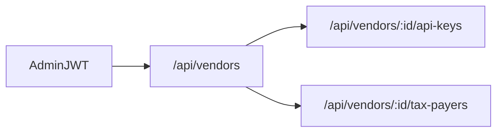

# Phase 2 — Admin APIs

**Depends on:** [phase-one.md](phase-one.md).  
**Delivers:** Migrations + Nest modules for vendors, API keys, tax-payer identity.  
**Next:** [phase-three.md](phase-three.md) — Sidecar + onboard.

Platform-admin HTTP APIs. Auth: existing JWT (`Authorization: Bearer`). Role **ADMIN** only. Vendors still do not log in. Do **not** accept `sk_test_` / `sk_live_` as request auth yet (that starts in Phase 3).

## This phase

- Vendor CRUD
- Generate / list / revoke API keys (`expires_at`, `last_used_at` column ready)
- Tax payer identity CRUD (CSR form fields + seller address fields)
- Shared Stripe-like error envelope
- Encrypt secrets at rest (app key)



Follow Nest patterns in [`backend/src/app/modules/user`](../backend/src/app/modules/user): entity, DTO, Swagger, `AuthGuard` + `RolesGuard`, pagination headers.

---

## Schema / migrations

Hand-written TypeORM migrations (same style as [`CreateUserTable`](../backend/src/database/migrations/1720796623509-CreateUserTable.ts)). `synchronize: false`.

Create `software_vendors`, `api_keys`, `tax_payers` from Phase 1 (including `expires_at`, `last_used_at`, seller address, `zatca_environment`, onboard columns as nullable). **Do not** create `invoices` yet.

---

## Error envelope (all APIs from here on)

```json
{
  "error": {
    "type": "invalid_request",
    "code": "vat_invalid",
    "message": "VAT must be 15 digits starting and ending with 3",
    "zatca_code": null
  }
}
```

`zatca_code` is filled when Fatoora/SDK returns a `BR-*` / `BR-KSA-*` (Phases 3–4).

---

## Vendors

`/api/vendors` — ADMIN. Soft-delete (`deleted_at`). 409 if deleting a vendor that still has tax payers.

| Method | Path | Body / notes |
| --- | --- | --- |
| `POST` | `/api/vendors` | `name` required. `slug` optional (slugify `name` if omitted). `status` default `active` |
| `GET` | `/api/vendors` | Paginated list |
| `GET` | `/api/vendors/:id` | |
| `PUT` | `/api/vendors/:id` | `name`, `slug`, `status` (`active` \| `suspended`) |
| `DELETE` | `/api/vendors/:id` | Soft delete. 409 if tax payers exist |

| Attribute | Type | Nullable | Notes |
| --- | --- | --- | --- |
| `name` | string | no | Company / product name |
| `slug` | string | yes on create | Unique. Generated from `name` if missing |
| `status` | enum | yes | `active` \| `suspended`. Default `active` |

---

## API keys

Nested under the vendor. Generate, list, revoke — no update of the secret (rotation is Phase 5).

| Method | Path | Notes |
| --- | --- | --- |
| `POST` | `/api/vendors/:id/api-keys` | Create. Returns plaintext `key` **once** |
| `GET` | `/api/vendors/:id/api-keys` | Metadata only (no hash, no plaintext) |
| `POST` | `/api/vendors/:id/api-keys/:keyId/revoke` | Sets `revoked_at`. Idempotent if already revoked |

### Generate body

| Attribute | Type | Nullable | Notes |
| --- | --- | --- | --- |
| `prefix` | enum | no | `sk_test_` \| `sk_live_` |
| `expiresAt` | ISO datetime | one of | Absolute expiry |
| `expiresInDays` | number | one of | Relative expiry if `expiresAt` omitted |

Server generates `prefix` + random secret, stores SHA-256 `key_hash` and `last4`. Never log the plaintext.

### Generate response (only this call includes `key`)

| Attribute | Notes |
| --- | --- |
| `id` | |
| `key` | Full secret, shown once |
| `prefix` | |
| `last4` | |
| `expiresAt` | |
| `lastUsedAt` | null |
| `revokedAt` | null |
| `createdAt` | |

### List item

Same fields **except** `key`. Include `expired: true` when `expiresAt` is in the past.

A key is unusable when `revoked_at` is set **or** `expires_at` is in the past. From Phase 3 onward, successful `sk_*` auth updates `last_used_at`.

---

## Tax payers

Identity only — CSR form fields from [CSR-FORM.md](../sdk/CSR-FORM.md) plus seller address for later UBL. Nested under vendor. Unique `(vendor_id, vat_number)`.

| Method | Path |
| --- | --- |
| `POST` | `/api/vendors/:id/tax-payers` |
| `GET` | `/api/vendors/:id/tax-payers` |
| `GET` | `/api/vendors/:id/tax-payers/:taxPayerId` |
| `PUT` | `/api/vendors/:id/tax-payers/:taxPayerId` |
| `DELETE` | `/api/vendors/:id/tax-payers/:taxPayerId` |

### Create / update body

| Attribute | Type | Nullable | Notes |
| --- | --- | --- | --- |
| `vatNumber` | string | no | `/^3\d{13}3$/`, 11th digit `0` (no VAT groups) |
| `legalName` | string | no | |
| `organizationUnitName` | string | no | Branch |
| `locationAddress` | string | no | Wasel `/^[A-Z]{4}\d{4}$/` |
| `industryBusinessCategory` | string | no | |
| `invoiceType` | enum | no | `both` \| `standard` \| `simplified`. Default `both` |
| `streetName` | string | yes | Required before live invoices |
| `buildingNumber` | string | yes | |
| `district` | string | yes | |
| `city` | string | yes | |
| `postalZone` | string | yes | |
| `sellerIdScheme` | string | yes | Default `CRN` |
| `sellerIdValue` | string | yes | |

Server sets `country = SA`. Create sets `status = draft`. 409 on duplicate VAT for that vendor.

Do **not** accept or return: `csrConfig`, `privateKeyEncrypted`, `csrPem`, `complianceRequestId`, `complianceCsid`, `complianceCsidSecret`, `productionCsid`, `productionCsidSecret`, `icv`, `lastPih`, onboard progress secrets.

---

## Security

- Hash API keys; encrypt any future CSID / private key columns with an app encryption key
- Do not log PEM, OTP, or raw keys
- Soft-delete via `deleted_at`; list/get exclude deleted

---

## Modules

- [`backend/src/app/modules/vendor/`](../backend/src/app/modules/vendor/)
- [`backend/src/app/modules/api-key/`](../backend/src/app/modules/api-key/)
- [`backend/src/app/modules/tax-payer/`](../backend/src/app/modules/tax-payer/)
- Enums under [`backend/src/core/enums/`](../backend/src/core/enums/)

Register in [`backend/src/app/app.module.ts`](../backend/src/app/app.module.ts).

---

## Out of scope

- Invoice table and invoice APIs
- CSR / CSID / sign / Fatoora
- Vendor `sk_*` request auth (Phase 3)
- Key rotation (Phase 5)
- Dashboard UI
