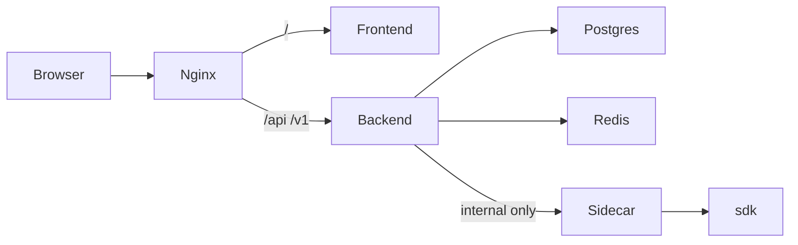

# Phase 0 — Docker Compose stack

**Depends on:** nothing.  
**Delivers:** Root compose for Nest, Next, Postgres, Redis, Java sidecar, nginx + Dockerfiles + env contract.  
**Next:** [phase-one.md](phase-one.md) — Backend ERD.

Local/dev runtime only. No product APIs, no Fatoora calls, no schema migrations in this phase.

## Why this phase

Later phases assume services can talk to each other. Phase 0 freezes the topology and env names so Phase 1+ code targets real hostnames (`postgres`, `redis`, `sidecar`) instead of reinventing Docker mid-feature.

Existing pieces to absorb or replace:

- [`backend/Dockerfile`](../backend/Dockerfile) — keep / refine
- [`backend/docker-compose.yml`](../backend/docker-compose.yml) — retire; root compose becomes source of truth
- [`backend/nginx.conf`](../backend/nginx.conf) — retire; use root [`nginx/nginx.conf`](../nginx/nginx.conf)

## Architecture



| Service | Build / image | Listen | Published | Role |
| --- | --- | --- | --- | --- |
| `nginx` | `nginx:1.27-alpine` | `80` | `${NGINX_PORT:-80}` | Public edge |
| `frontend` | `frontend/Dockerfile` | `3000` | none | Next.js admin UI |
| `backend` | `backend/Dockerfile` | `8080` | none | Nest API |
| `sidecar` | `sidecar/Dockerfile` | `8090` | none | Java 11–14 + `sdk/` (fatoora) |
| `postgres` | `postgres:16-alpine` | `5432` | `${POSTGRES_PORT:-5432}` | System of record |
| `redis` | `redis:7-alpine` | `6379` | `${REDIS_PORT:-6379}` | BullMQ + rate limits (Phases 3–5) |

Sidecar is **never** on nginx. Backend calls `SIDECAR_URL=http://sidecar:8090`.

### Why Redis

Not for Phase 0 app logic. Included so the stack matches the roadmap: BullMQ onboard/invoice workers (Phases 3–4) and per-key rate limits (Phase 5). Postgres remains the source of truth.

## Files this phase creates

| Path | Purpose |
| --- | --- |
| [`docker-compose.yml`](../docker-compose.yml) | Root compose (all services) |
| [`.env.example`](../.env.example) | Single env template for compose |
| [`nginx/nginx.conf`](../nginx/nginx.conf) | Edge routing |
| [`frontend/Dockerfile`](../frontend/Dockerfile) | Next.js image |
| [`sidecar/Dockerfile`](../sidecar/Dockerfile) | Temurin 11 + `sdk/` + health stub |
| [`sidecar/README.md`](../sidecar/README.md) | Sidecar notes; real ops in Phase 3 |

Align [`backend/.env.example`](../backend/.env.example) and [`frontend/.env.example`](../frontend/.env.example) with the same keys for non-Docker local runs.

## Nginx

```
/api/*  → backend:8080
/v1/*   → backend:8080
/       → frontend:3000
```

- `client_max_body_size 10m`
- Forward `Host`, `X-Real-IP`, `X-Forwarded-For`, `X-Forwarded-Proto`
- WebSocket upgrade headers for Next

Browser must call the gateway through nginx (`PUBLIC_URL`), not `backend:8080` directly. Set `NEXT_PUBLIC_BACKEND_URL` to that public origin (e.g. `http://localhost`).

## Sidecar (Phase 0 baseline)

- Image: Eclipse Temurin **11** JRE (SDK requires Java 11–14)
- Bake or bind-mount [`sdk/`](../sdk/) at `/opt/zatca-sdk` (`FATOORA_HOME`)
- Install `jq` if launchers need it; prefer `java -jar` + `SDK_CONFIG` (see [phase-three.md](phase-three.md))
- Phase 0 HTTP surface only:
  - `GET /health` → `200`
  - `POST /internal/*` → `501` stubs until Phase 3
- Real CSR / sign / validate / invoice-request + per-job sandbox = **Phase 3**
- Do not publish `8090` to the host by default
- Do not use SDK dummy `cert.pem` / keys as live tax payer secrets

## Env contract (root `.env.example`)

```env
# Edge
NGINX_PORT=80
PUBLIC_URL=http://localhost

# Postgres
POSTGRES_DB=zatca_gateway
POSTGRES_USER=postgres
POSTGRES_PASSWORD=postgres
POSTGRES_PORT=5432

# Redis
REDIS_PORT=6379
REDIS_URL=redis://redis:6379

# Backend (Nest)
APP_SECRET_KEY=change-me
PORT=8080
DATABASE_NAME=zatca_gateway
DATABASE_HOST=postgres
DATABASE_PORT=5432
DATABASE_USER=postgres
DATABASE_PASSWORD=postgres
DATABASE_LOGGING=false
DATABASE_SYNCHRONIZE=false
DATABASE_MIGRATIONS_RUN=true
REDIS_HOST=redis
REDIS_PORT=6379
SIDECAR_URL=http://sidecar:8090
SIDECAR_MAX_CONCURRENT=8
ZATCA_ENV=simulation
ZATCA_SIMULATION_BASE_URL=https://gw-fatoora.zatca.gov.sa/e-invoicing/simulation
ZATCA_PRODUCTION_BASE_URL=https://gw-fatoora.zatca.gov.sa/e-invoicing/core

# Frontend (Next)
NEXTAUTH_SECRET=change-me-nextauth
NEXT_PUBLIC_BACKEND_URL=http://localhost
NEXT_PUBLIC_APP_URL=http://localhost

# Sidecar
SIDECAR_PORT=8090
FATOORA_HOME=/opt/zatca-sdk
```

Compose injects these per service. Never commit a real `.env` with production secrets.

Fatoora URL + `ZatcaClient` behavior: [phase-three.md](phase-three.md). Swagger PDFs: [sdk/fatoora-swagger/](../sdk/fatoora-swagger/).

## How to run (when implemented)

```bash
cp .env.example .env
docker compose up --build
```

Smoke:

- `http://localhost/` → frontend
- `http://localhost/api/...` → backend (once Nest is up)
- Sidecar health only from inside the network: `http://sidecar:8090/health`

## Out of scope

- TypeORM entities / migrations (Phase 1–2)
- Real sidecar fatoora ops and `ZatcaClient` (Phase 3)
- Live invoices (Phase 4)
- Webhooks, rate-limit code, admin dashboard features (Phase 5)
- TLS, Kubernetes, production hardening
- RabbitMQ / Spring Boot
