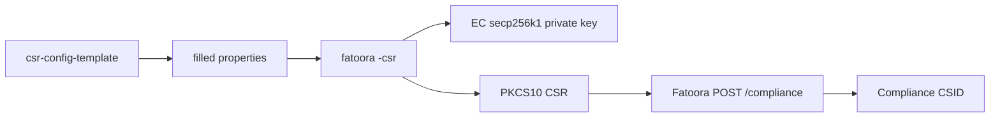

# CSR config template (Fatoora SDK)

The file [Data/Input/csr-config-template.properties](Data/Input/csr-config-template.properties) is **not** a certificate. It is an empty key=value form. The SDK copies these values into a **Certificate Signing Request** that you later POST to Fatoora with an OTP to get a CSID.

Filled examples live next to it:

- [Data/Input/csr-config-example-EN.properties](Data/Input/csr-config-example-EN.properties) — normal taxpayer
- [Data/Input/csr-config-example-EN-VAT-group.properties](Data/Input/csr-config-example-EN-VAT-group.properties) — VAT group
- Arabic twins: `csr-config-example-AR.properties`, `csr-config-example-AR-VAT-Group.properties`



Typical command (from [Configuration/usage.txt](Configuration/usage.txt)):

```bash
fatoora -csr -csrConfig Data/Input/csr-config-example-EN.properties -privateKey key.pem -generatedCsr req.csr -pem -sim
```

Environment is **not** in this file. Flags on the CLI select the CSR template OID:

- `-sim` — simulation (`TSTZATCA-Code-Signing`)
- `-nonprod` — developer portal (`PREZATCA-Code-Signing`)
- neither — production (`ZATCA-Code-Signing`)

Crypto: **EC secp256k1**, SHA256withECDSA, PKCS#10. One filled file = **one EGS device** = one keypair = one CSID.

---

## Field by field (SDK properties)

Using the English sample:

| Property | X.509 / CSR role | Example | What to put |
|---|---|---|---|
| `csr.common.name` | Subject **CN** | `TST-886431145-399999999900003` | Unique name of this solution unit. Simulation often uses `TST-<solution-or-TIN>-<15-digit-VAT>`. Production uses the real EGS/solution name (no `TST-` prefix). |
| `csr.serial.number` | Subject serial (`SERIALNUMBER`) | `1-TST\|2-TST\|3-ed22f1d8-e6a2-1118-9b58-d9a8f11e445f` | Device identity: `1-<Manufacturer>\|2-<Model>\|3-<EGS-UUID>`. The UUID must be unique per device. |
| `csr.organization.identifier` | VAT / organization identifier (ZATCA OID) | `399999999900003` | **15-digit VAT**. Saudi VAT starts and ends with `3`. |
| `csr.organization.unit.name` | Subject **OU** | `Riyadh Branch` | Branch name for a normal taxpayer. For a VAT group, the **10-digit group TIN** (sample: `3999999999`). |
| `csr.organization.name` | Subject **O** | `Maximum Speed Tech Supply LTD` | Legal name as registered. Arabic is allowed (see AR examples). |
| `csr.country.name` | Subject **C** | `SA` | Always `SA`. |
| `csr.invoice.type` | ZATCA invoice-type bitmap | `1100` | Four digits (see below). |
| `csr.location.address` | Branch location | `RRRD2929` | Short address; samples use the Saudi National Address (Wasel) 4-letter + 4-digit code. |
| `csr.industry.business.category` | Industry | `Supply activities` | Free-text sector. Arabic is allowed. |

### VAT number vs VAT group

Normal taxpayer (11th digit `0`):

- identifier `399999999900003`
- OU = branch name (`Riyadh Branch`)

VAT group (11th digit `1`):

- identifier `399999999910003`
- OU = group TIN `3999999999`

**v1 product scope:** normal taxpayer only. VAT groups are out of scope until a later version.

### `csr.invoice.type` bitmap

Four characters, each `0` or `1`:

1. Standard tax invoices (B2B / B2G, clearance)
2. Simplified tax invoices (B2C, reporting)
3. Reserved — keep `0`
4. Reserved — keep `0`

So `1100` = both types, `1000` = standard only, `0100` = simplified only. This is **not** the same as UBL `InvoiceTypeCode` (`388` / `381` / `383`) or KSA-2 `@name` (`0100000` / `0200000`).

---

## What this file does not contain

- OTP, CSID, or the certificate itself
- Private key (SDK generates that as a sibling output)
- Environment URL (you choose `-sim` / `-nonprod` / production, then HTTP yourself)
- Invoice XML, hash, QR, or PIH

After generation you send the CSR to Fatoora (`POST /compliance`). The SDK never calls ZATCA.

---

## Gateway mapping

Tax payer row stores identity. On first onboard, backend auto-creates one `egs_devices` row and fills CSR serial/CN. The private key from `-csr` is a secret; the properties file is identity metadata only.

---

## CSR form (v1)

Dashboard form that fills a Fatoora CSR. The UI uses camelCase; the backend maps to `csr.*` and auto-fills country + EGS.

Locked:

- Country always `SA` (hidden)
- Normal taxpayer only (no `isVatGroup`)
- Env is SDK config (no `zatcaEnvironment`)
- EGS serial / UUID / common name auto-generated
- OTP / CSID later, not this form
- `crn` is not a CSR field — omit for now

```ts
type InvoiceType = "both" | "standard" | "simplified";

type CsrFormValues = {
  vatNumber: string;
  organizationName: string;
  organizationUnitName: string;
  locationAddress: string;
  industryBusinessCategory: string;
  invoiceType: InvoiceType;
};
```

Defaults:

```ts
{
  vatNumber: "",
  organizationName: "",
  organizationUnitName: "",
  locationAddress: "",
  industryBusinessCategory: "Supply activities",
  invoiceType: "both",
}
```

### `vatNumber` → `csr.organization.identifier`

VAT / الرقم الضريبي. Required text.

15-digit KSA VAT that ZATCA binds the certificate to.

- Pattern `/^3\d{13}3$/` (starts and ends with `3`)
- 11th digit (index `10`) must be `0` (normal taxpayer). `1` is a VAT group — reject
- No letters, spaces, or 10-digit TIN-only values
- Example: `399999999900003`

### `organizationName` → `csr.organization.name`

Legal name / الاسم القانوني. Required text.

Name as registered with ZATCA. One field, Arabic or English.

- Trim, min 1 char
- Example: `Maximum Speed Tech Supply LTD`

### `organizationUnitName` → `csr.organization.unit.name`

Branch / الوحدة التنظيمية. Required text.

Branch this unit represents. v1 always a branch name, never the 10-digit TIN.

- Example: `Riyadh Branch` / `فرع الرياض`

### `locationAddress` → `csr.location.address`

National address / العنوان الوطني. Required text.

Wasel short code, not a street line.

- Pattern `/^[A-Z]{4}\d{4}$/`
- Example: `RRRD2929`

### `industryBusinessCategory` → `csr.industry.business.category`

Industry / النشاط. Required select (Other = free text, Arabic allowed).

Options: `Supply activities` | `Retail` | `Wholesale` | `Construction` | `Food and beverages` | `Healthcare` | `Information technology` | `Transportation and logistics` | `Real estate` | `Education` | `Manufacturing` | `Hospitality` | `Professional services` | Other

Default: `Supply activities`

### `invoiceType` → `csr.invoice.type`

Invoice kinds / أنواع الفواتير. Required select.

Not UBL `388`/`381`/`383` and not KSA-2 `@name`. Backend converts enum to the 4-digit CSR bitmap.

- `both` → `1100` (standard + simplified)
- `standard` → `1000` (B2B / B2G only)
- `simplified` → `0100` (B2C only)

Default: `both`

### Hidden / auto (not on the form)

- `csr.country.name` = `SA`
- `csr.serial.number` = `1-Antoor|2-Gateway|3-{uuid}`
- `csr.common.name` = `TST-{tin}-{vat}` in simulation/developer, `{manufacturer}-{vat}` in production (`tin` = `vatNumber.slice(0, 10)`)

### Filled form example

```json
{
  "vatNumber": "399999999900003",
  "organizationName": "Maximum Speed Tech Supply LTD",
  "organizationUnitName": "Riyadh Branch",
  "locationAddress": "RRRD2929",
  "industryBusinessCategory": "Supply activities",
  "invoiceType": "both"
}
```

That maps to:

```
csr.common.name=<auto>
csr.serial.number=<auto>
csr.organization.identifier=399999999900003
csr.organization.unit.name=Riyadh Branch
csr.organization.name=Maximum Speed Tech Supply LTD
csr.country.name=SA
csr.invoice.type=1100
csr.location.address=RRRD2929
csr.industry.business.category=Supply activities
```
