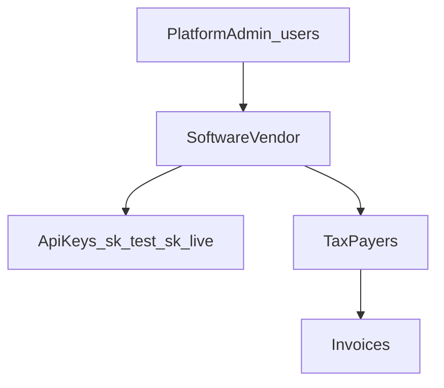
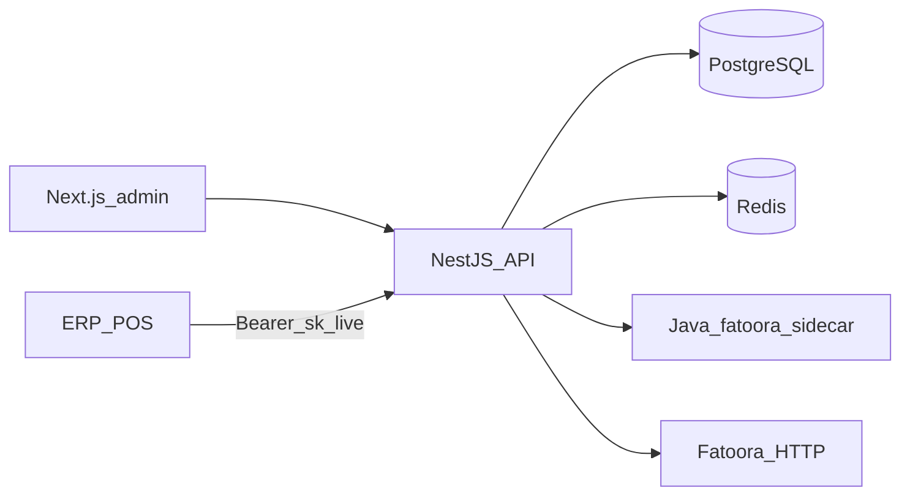

# ZATCA SaaS Gateway (Stripe-style)

Build a **tax invoicing gateway**: software vendors (ERP/POS) are the customers. They get API tokens, onboard **tax payers** under their account, and submit invoices through your API.

**Decided stack:** NestJS API + Java 11–14 sidecar (`fatoora` SDK) + Next.js admin dashboard + PostgreSQL + Redis. No Spring Boot. No RabbitMQ.

Reference study: [ZATCA-SDK-STUDY.md](ZATCA-SDK-STUDY.md).  
Delivery roadmap: [plan/README.md](../plan/README.md).

---

## Product model (software-first)

Stripe mapping:

- Stripe **platform account** → **software vendor** (ERP/POS company)
- Stripe **secret key** (`sk_test_` / `sk_live_`) → **API token** for that vendor
- Stripe **connected account** → **tax payer** (VAT-registered business)
- Stripe **PaymentIntent** → **invoice** (sign + clearance or reporting)
- Stripe **Dashboard** → platform-admin frontend (vendors, keys, payers, invoices)

Schema: [plan/phase-one.md](../plan/phase-one.md).



Rules:

- A vendor never sees another vendor’s tax payers or invoices.
- Platform admin creates vendors and controls the dashboard. Vendors use API keys on `/v1`.
- One tax payer = one EGS in v1 (CSR/CSID/ICV/PIH on the tax payer row).
- A key can reach all tax payers of that vendor.
- **Test mode** → ZATCA simulation. **Live mode** → production. Key prefix selects the mode.

---

## Stack (locked)

**NestJS** (`backend/`) is the public SaaS: vendors, API keys, tax payers, invoices, Fatoora HTTP, webhooks, dashboard API.

**Java sidecar** is the only place the official SDK runs. It must use **Java 11–14**. It only does CSR, sign, hash, QR, validate, and invoice-request JSON — each call in a **per-job sandbox** so many tax payers can run at once.

**Next.js** (`frontend/`) is the **platform-admin** portal. **PostgreSQL** is the system of record. **Redis** is for BullMQ jobs and rate limits.



---

## Backend responsibilities

**NestJS owns**

- Platform admin login (existing users)
- API keys (create, show-once, hash at rest, revoke, rotate)
- Tax payer CRUD and onboarding state
- Invoice API, idempotency, status
- Fatoora HTTP (compliance CSID, production CSID, clearance, reporting)
- Webhooks to the vendor
- Encryption of ZATCA secrets
- Audit log
- Rate limits

**Java sidecar owns** (existing SDK only)

- CSR + key generation
- Sign, hash, QR, local validate
- API request JSON `{ invoiceHash, uuid, invoice }`
- Per-job sandbox (own cert / key / PIH per tax payer)

Sidecar interface (internal, not public):

- `POST /internal/csr`
- `POST /internal/sign`
- `POST /internal/validate`
- `POST /internal/hash`
- `POST /internal/invoice-request`

Run sidecar with `FATOORA_HOME` / `SDK_CONFIG`. On Linux, call `java -jar` directly so the 6-arg `fatoora` script does not truncate commands.

---

## Database

PostgreSQL + TypeORM. Full schema: [plan/phase-one.md](../plan/phase-one.md).

Platform admin creates vendors and manages tax payers, invoices, and API keys. Vendors do not log in; they use `sk_*` keys.

Five core tables: `users` (platform admins), `software_vendors`, `api_keys`, `tax_payers` (identity + SDK/CSID/ICV + onboard progress), `invoices`. Phase 5 adds `webhook_endpoints`, `webhook_deliveries`, `audit_logs`.

Secrets encrypted at rest, never stored as raw PEM in logs. ICV + PIH live on the tax payer in v1 and must survive restarts.

---

## Public API (token-driven)

Auth: `Authorization: Bearer sk_live_...` or `sk_test_...`.

Create the secret once, show it **once**, store only a hash (Stripe pattern).

Admin (JWT) stays under `/api/vendors`, `/api/vendors/:id/api-keys`, `/api/vendors/:id/tax-payers`.

```http
POST   /v1/taxpayers/:id/onboard/csr
POST   /v1/taxpayers/:id/onboard              # body { "otp" } → 202 worker
GET    /v1/taxpayers/:id/onboard              # progress poll

POST   /v1/invoices                            # Idempotency-Key required → 202
GET    /v1/invoices/:id
GET    /v1/invoices

POST   /v1/webhook_endpoints                   # Phase 5 (or admin /api equivalent)
```

Tax payer identity CRUD is admin `/api/...` in v1; vendor ERP focuses on onboard + invoices.

Invoice body (vendor sends business data, **not** signed XML):

- type, subtype, `taxPayerId`
- buyer (required for standard)
- lines, discounts, tax category/percent, currency, issue date/time
- credit/debit: original invoice id + instruction note

Gateway then: build UBL → sidecar sign/validate (sandbox) → POST Fatoora clearance (standard) or reporting (simplified) → store next PIH → return status + QR / cleared XML.

Errors: Stripe-like `{ "error": { "type", "code", "message", "zatca_code" } }`.

---

## Frontend (Next.js)

Platform-admin portal (not vendor self-signup in v1):

1. **Auth** — admin login
2. **Overview** — tax payer count, invoice success/fail, ZATCA env
3. **Tax payers** — list, create, edit, onboard status. CSR form: [CSR-FORM.md](CSR-FORM.md)
4. **Keys** — create / revoke / rotate, last used, test vs live, expiry
5. **Invoices** — search, status, ZATCA errors, XML/hash (no private keys)
6. **Developers** — webhook URL, recent deliveries
7. **Settings** — vendor profile

UI should make onboarding states obvious: `Draft → CSR created → Compliance CSID → Samples → PCSID / onboarded`.

---

## Security (non-negotiable)

- Hash API keys; encrypt CSID + private keys at rest
- Test keys can never hit production Fatoora
- Rate limit per key; idempotency on invoice create
- Do not log PEM, OTP, or raw keys
- Sidecar is internal-only (network policy); one sandbox per job
- Java 11–14 only for the sidecar; Nest can run on current Node

---

## Delivery phases

**Phase 1 — ERD:** [plan/phase-one.md](../plan/phase-one.md) — vendors, keys, tax payers, invoices columns.

**Phase 2 — Admin APIs:** [plan/phase-two.md](../plan/phase-two.md) — vendor CRUD, API keys (generate / list / revoke + expiration), tax-payer identity.

**Phase 3 — Sidecar + onboard:** [plan/phase-three.md](../plan/phase-three.md) — Java sandbox, CSR, OTP worker (CSID + six samples + PCSID), progress poll.

**Phase 4 — Invoices:** [plan/phase-four.md](../plan/phase-four.md) — UBL generator, six types, discount/VAT/credit/debit, clearance/reporting.

**Phase 5 — Harden:** [plan/phase-five.md](../plan/phase-five.md) — webhooks, rate limits, audit, key rotate, admin dashboard.

Start Phases 1–3 against **simulation** (`-sim` / simulation base URL). Do not put dummy SDK certs into live tax payer rows.

---

## Implementation checklist

- NestJS API + Next.js admin + Java 11–14 sidecar wrapping fatoora
- PostgreSQL schema: [plan/phase-one.md](../plan/phase-one.md)
- Admin pages: vendors, tax payers, API keys create-revoke-rotate
- Sidecar with per-job sandbox (CSR, sign, validate, hash, invoice-request)
- Fatoora HTTP + UBL builder + ICV/PIH + clearance/reporting + invoice log + webhooks

---

## Repo layout

Product code is not inside the SDK zip:

- `backend/` — NestJS
- `frontend/` — Next.js admin dashboard
- `sdk/` — official fatoora toolkit (runtime dependency for the sidecar)
- `plan/` — delivery phases

Keep the Java SDK as a dependency/runtime for the sidecar, not as the SaaS codebase.
