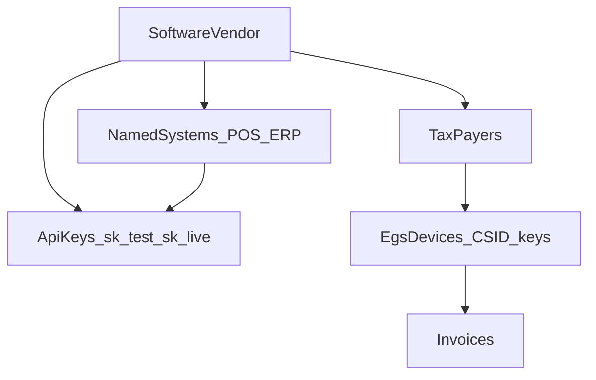
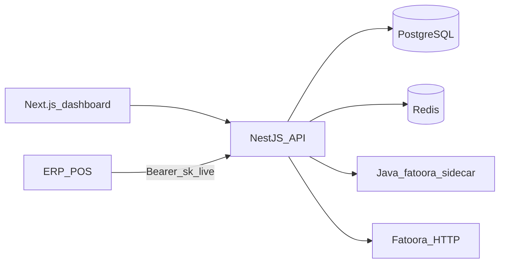

# ZATCA SaaS Gateway (Stripe-style)

Build a **tax invoicing gateway**: software vendors (ERP/POS) are the customers. They get API tokens, onboard **tax payers** under their account, and submit invoices through your API.

**Decided stack:** NestJS API + Java 11–14 sidecar (`fatoora` SDK) + Next.js dashboard + PostgreSQL. No Spring Boot path.

Reference study: [ZATCA-SDK-STUDY.md](ZATCA-SDK-STUDY.md).

---

## Product model (software-first)

Stripe mapping:

- Stripe **platform account** → **software vendor** (ERP/POS company)
- Stripe **secret key** (`sk_test_` / `sk_live_`) → **API token** for that vendor (or a named system under it)
- Stripe **connected account** → **tax payer** (VAT-registered business)
- Stripe **PaymentIntent** → **invoice** (sign + clearance or reporting)
- Stripe **Dashboard** → frontend for tax payers, systems/keys, invoice logs



Rules:

- A vendor never sees another vendor’s tax payers or invoices.
- One tax payer can have multiple **EGS devices** (ZATCA: one CSR/CSID per device).
- Tokens can be **unrestricted** (all tax payers of the vendor) or **restricted** (one system, optional tax-payer allowlist, scopes).
- **Test mode** → ZATCA simulation/developer. **Live mode** → production. Key prefix selects the mode (same as Stripe).

---

## Stack (locked)

**NestJS** is the public SaaS: vendors, API keys, tax payers, invoices, Fatoora HTTP, webhooks, dashboard API.

**Java sidecar** is the only place the official SDK runs. It must use **Java 11–14**. It only does CSR, sign, hash, QR, validate, and invoice-request JSON.

**Next.js** is the vendor portal. **PostgreSQL** is the system of record. **Redis** is for rate limits and jobs.



---

## Backend responsibilities

**NestJS owns**

- Vendor signup/login, team users
- API keys (create, show-once, hash at rest, revoke, rotate)
- Tax payer CRUD and onboarding state
- Invoice API, idempotency, status
- Fatoora HTTP (compliance CSID, production CSID, clearance, reporting)
- Webhooks to the vendor
- Encryption of ZATCA secrets
- Audit log

**Java sidecar owns** (existing SDK only)

- CSR + key generation
- Sign, hash, QR, local validate
- API request JSON `{ invoiceHash, uuid, invoice }`

Sidecar interface (internal, not public):

- `POST /internal/csr`
- `POST /internal/sign`
- `POST /internal/validate`
- `POST /internal/hash`
- `POST /internal/invoice-request`

Run sidecar with `FATOORA_HOME` / `SDK_CONFIG`. On Linux, call `java -jar` directly so the 6-arg `fatoora` script does not truncate commands.

---

## Database (first cut)

PostgreSQL. Secrets encrypted (app key or KMS), never stored as raw PEM in logs.

**Identity**

- `software_vendors` — name, slug, status
- `users` — dashboard users, `vendor_id`, role (`owner`, `admin`, `viewer`)
- `systems` — named integrating apps (`POS`, `ERP`), `vendor_id`
- `api_keys` — `vendor_id`, optional `system_id`, prefix (`sk_test_` / `sk_live_`), **hashed** secret, scopes JSON, optional `taxpayer_ids`, `last_used_at`, revoked_at

**Tax payers**

- `tax_payers` — `vendor_id`, VAT (15 digits), legal name, CRN, address, industry, invoice-type bitmap (`1100`), ZATCA env, status (`draft`, `compliance`, `production`, `suspended`)
- `egs_devices` — `tax_payer_id`, serial (`1-Mfg|2-Model|3-UUID`), encrypted private key, compliance CSID, production CSID, ICV, last PIH, status

**Traffic**

- `invoices` — device_id, type (`388`/`381`/`383`), subtype (standard/simplified), UUID, hash, ICV, PIH, XML refs, ZATCA request/response, status (`signed`, `cleared`, `reported`, `rejected`)
- `webhook_endpoints` / `webhook_deliveries`
- `audit_logs` — actor (user or api_key), action, entity

ICV + PIH are **per EGS device** and must survive restarts. Never reuse or skip.

---

## Public API (token-driven)

Auth: `Authorization: Bearer sk_live_...` or `sk_test_...`.

Create the secret once, show it **once**, store only a hash (Stripe pattern).

```http
POST   /v1/taxpayers
GET    /v1/taxpayers
GET    /v1/taxpayers/:id
POST   /v1/taxpayers/:id/onboard/csr
POST   /v1/taxpayers/:id/onboard/csid          # OTP from Fatoora
POST   /v1/taxpayers/:id/onboard/production-csid

POST   /v1/invoices                            # Idempotency-Key required
GET    /v1/invoices/:id
GET    /v1/invoices

POST   /v1/webhook_endpoints
```

Invoice body (vendor sends business data, **not** signed XML):

- type, subtype, seller snapshot (or `taxpayer_id` + `device_id`)
- buyer (required for standard)
- lines, totals, currency, issue date/time
- credit/debit: original invoice id

Gateway then: build UBL → sidecar sign/validate → POST Fatoora clearance (standard) or reporting (simplified) → store next PIH → return status + QR / cleared XML.

Errors: Stripe-like `{ "error": { "type", "code", "message", "zatca_code" } }`.

---

## Frontend (Next.js)

Vendor portal (not a public marketing site in v1):

1. **Auth** — login, invite team
2. **Overview** — tax payer count, invoice success/fail, ZATCA env
3. **Tax payers** — list, create, edit, onboarding wizard (CSR fields, OTP, CSID/PCSID status, devices). CSR form fields and rules: [CSR-FORM.md](CSR-FORM.md).
4. **Systems & keys** — systems, create/revoke/rotate keys, scopes, last used, test vs live
5. **Invoices** — search, status, ZATCA errors, XML/hash (no private keys)
6. **Developers** — webhook URL, recent deliveries, API docs snippet
7. **Settings** — vendor profile

Optional later: **platform admin** (your company) to approve vendors.

UI should make onboarding states obvious: `Draft → CSR created → Compliance CSID → Samples passed → Production CSID`.

---

## Security (non-negotiable)

- Hash API keys; encrypt CSID + private keys at rest
- Test keys can never hit production Fatoora
- Rate limit per key; idempotency on invoice create
- Do not log PEM, OTP, or raw keys
- Sidecar is internal-only (network policy)
- Java 11–14 only for the sidecar; Nest can run on current Node

---

## Delivery phases

**Phase 1 — Foundation:** Nest app, Postgres schema, vendor + users, API keys, tax payers CRUD, Next.js lists for payers and systems/keys.

**Phase 2 — SDK sidecar:** Java service around `fatoora`; Nest calls it; sign/validate a sample XML end-to-end.

**Phase 3 — ZATCA onboarding:** CSR → compliance CSID → compliance invoices → PCSID, stored per device; dashboard wizard.

**Phase 4 — Invoice gateway:** UBL builder from JSON, ICV/PIH, clearance vs reporting, invoice log, `Idempotency-Key`.

**Phase 5 — Webhooks + hardening:** outbound events, key rotation, audit log, rate limits.

Start Phase 1–2 against **simulation** (`-sim` / simulation base URL). Do not put dummy SDK certs into live tax payer rows.

---

## Implementation checklist

- Scaffold monorepo: NestJS API, Next.js dashboard, Java 11–14 sidecar wrapping fatoora
- PostgreSQL schema: vendors, users, systems, hashed API keys, tax payers, EGS devices; Stripe-like `sk_test_` / `sk_live_` auth
- Next.js pages: tax payers CRUD + onboarding status, systems/API keys create-revoke-rotate
- Java sidecar wrapping fatoora (CSR, sign, validate, hash, invoice-request) with internal-only HTTP
- Fatoora HTTP + UBL builder + ICV/PIH + clearance/reporting + invoice log and webhooks

---

## What we will add in the repo

New app (not inside the SDK zip as the product root). Suggested layout:

- `apps/api` — NestJS
- `apps/web` — Next.js dashboard
- `apps/zatca-sidecar` — thin Java HTTP wrapper over the existing SDK
- `packages/shared` — API types (invoice, taxpayer, errors)

Keep [zatca-einvoicing-sdk-Java-238-R3.4.8](.) as a dependency/runtime for the sidecar, not as the SaaS codebase.
