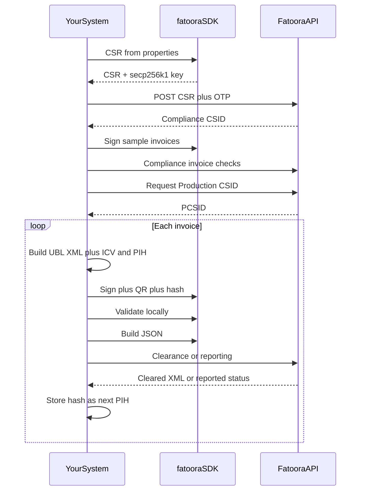

# ZATCA Java SDK 238-R3.4.8 — Study Report

This package is the official **ZATCA (Fatoora) Phase 2 local toolkit**. It is **not** a full HTTP client for the Fatoora portal. It validates, signs, hashes, generates QR codes, creates CSRs, and builds the JSON body you later POST yourself.

**Version:** `238-R3.4.8` ([Apps/global.json](Apps/global.json))  
**License:** GNU LGPL v3 ([LICENSE.txt](LICENSE.txt))  
**Java:** **11–14 only** (docs say `>=11` and `<15`)  
**No changelog** is shipped. There is **no Java source** — only a fat JAR, CLI wrappers, samples, schemas, and rules.

---

## 1. What this SDK is (and is not)

**It is:** an offline CLI (`fatoora`) wrapping `zatca-einvoicing-sdk-238-R3.4.8.jar`.

**It does:**

- Generate CSR + EC secp256k1 private key (onboarding)
- Sign UBL 2.1 invoices (XAdES, ECDSA-SHA256)
- Generate invoice hash (for PIH chaining)
- Generate QR (TLV, then base64)
- Validate locally (XSD + EN16931 + ZATCA KSA rules + PIH + QR + signature)
- Build API JSON: `{ invoiceHash, uuid, invoice }`

**It does not:**

- Call ZATCA APIs (no sandbox/production URLs inside the SDK)
- Submit invoices for clearance or reporting
- Complete onboarding (CSR must be sent to Fatoora by you)
- Generate the business XML from scratch (you build UBL XML; the SDK signs/validates it)

You still need your own HTTP client for Fatoora.


---

## 2. Package layout

```
zatca-einvoicing-sdk-Java-238-R3.4.8/
├── Apps/                    # CLI + version + expected fat JAR
│   ├── fatoora              # macOS/Linux launcher
│   ├── fatoora.bat          # Windows launcher
│   └── global.json          # "238-R3.4.8"
├── Configuration/
│   ├── config.json          # Absolute paths (created by install)
│   ├── defaults.json        # Relative path templates
│   └── usage.txt            # CLI flags
├── Data/
│   ├── Certificates/        # Dummy cert + EC key (test only)
│   ├── Input/               # CSR property templates
│   ├── PIH/pih.txt          # First-invoice previous-hash
│   ├── Rules/Schematrons/   # EN16931 + ZATCA XSL rules
│   ├── Samples/             # 18 signed UBL examples
│   └── Schemas/xsds/UBL2.1/ # Official UBL 2.1 XSDs
├── install.sh / install.bat
├── Readme/readme.md
└── LICENSE.txt
```

Launcher expects: `Apps/zatca-einvoicing-sdk-238-R3.4.8.jar`.  
Main class (from typical ZATCA builds): `com.zatca.sdk.MainApp`.

---

## 3. Install and run (macOS)

Prerequisites: **Java 11–14** and **jq**.

```bash
cd /Users/kholoudnafea/Downloads/zatca-einvoicing-sdk-Java-238-R3.4.8
sh install.sh
source ~/.zshrc
chmod +x Apps/fatoora
fatoora -help
```

Install writes `FATOORA_HOME`, `SDK_CONFIG`, and `PATH` into `~/.zshrc` / `~/.bash-profile`, and regenerates [Configuration/config.json](Configuration/config.json) with absolute paths.

Run without installing globally:

```bash
export FATOORA_HOME=".../Apps"
export SDK_CONFIG=".../Configuration/config.json"
"$FATOORA_HOME/fatoora" -help
```

**Known pitfalls**

- [Apps/fatoora](Apps/fatoora) forwards only **6 arguments** (`$1`–`$6`). Windows uses `%*` (all args). On macOS/Linux, long commands can be truncated — call `java -jar` directly if needed.
- `config.json` uses `Data/Rules/schematrons/` (lowercase) while the folder is `Schematrons/`. Fine on macOS; can break on Linux.
- Dummy files in [Data/Certificates/](Data/Certificates/) are **test-only**.

---

## 4. CLI commands

From [Configuration/usage.txt](Configuration/usage.txt) and [Readme/readme.md](Readme/readme.md):

| Flag | Purpose |
|------|---------|
| `-csr` + `-csrConfig` | Generate CSR + private key |
| `-pem` | PEM headers on CSR/key |
| `-privateKey` / `-generatedCsr` | Output paths |
| `-nonprod` | Non-production CSR template (`PREZATCA`) |
| `-sim` | Simulation CSR template (`TSTZATCA`) |
| `-invoice` | Input XML |
| `-sign` / `-signedInvoice` | Sign invoice |
| `-generateHash` | Invoice hash |
| `-qr` | QR (docs); some JAR builds use `-invoicewithqr` |
| `-validate` | Local validation |
| `-invoiceRequest` / `-apiRequest` | JSON payload |
| `-help` | Usage |

Examples:

```bash
fatoora -validate -invoice "Data/Samples/Standard/Invoice/Standard_Invoice.xml"
fatoora -sign -invoice invoice.xml -signedInvoice signed.xml
fatoora -generateHash -invoice invoice.xml
fatoora -qr -invoice invoice.xml
fatoora -csr -csrConfig Data/Input/csr-config-example-EN.properties -privateKey key.pem -generatedCsr req.csr -pem -sim
fatoora -invoice signed.xml -invoiceRequest -apiRequest request.json
```

Official Java integration is a **subprocess**, not a documented library API:

```java
Runtime.getRuntime().exec("fatoora -generateHash -invoice path/to/invoice.xml");
```

Default outputs if paths are omitted:

- Key: `generated-private-key-yyyyMMddhhmmss.key`
- CSR: `generated-csr-yyyyMMddhhmmss.csr`
- Signed XML: `<input>_signed.xml`
- JSON: `generated-json-request-yyyyMMddhhmmss.json`

Without `-pem`, the private key is written **without** `BEGIN/END EC PRIVATE KEY` headers (the format `cert.pem` / signing also expect).

---

## 5. End-to-end workflow you will actually run



### Phase A — Onboarding (once per EGS / device)

1. Fill a CSR properties file (see section 6).
2. `fatoora -csr ... -sim` (or `-nonprod` / default production).
3. Get OTP from Fatoora portal.
4. POST CSR to ZATCA **compliance** CSID API (outside SDK).
5. Save returned certificate as `Data/Certificates/cert.pem` (**no PEM headers, no newlines**).
6. Save private key as `Data/Certificates/ec-secp256k1-priv-key.pem` (**no headers**).
7. Sign and submit compliance invoices (standard + simplified as required).
8. Request **Production CSID (PCSID)**.
9. Use PCSID + same private key for live signing.

Environments (CSR template only; HTTP is yours):

- Default: production (`ZATCA-Code-Signing`)
- `-nonprod`: developer portal (`PREZATCA-Code-Signing`)
- `-sim`: simulation (`TSTZATCA-Code-Signing`)

Typical Fatoora bases (not in this SDK; from ZATCA docs):

- Developer: `https://gw-fatoora.zatca.gov.sa/e-invoicing/developer-portal`
- Simulation: `https://gw-fatoora.zatca.gov.sa/e-invoicing/simulation`
- Production: `https://gw-fatoora.zatca.gov.sa/e-invoicing/core`

Typical paths you will call yourself:

- `POST /compliance` — compliance CSID
- `POST /compliance/invoices` — compliance checks
- `POST /production/csids` — production CSID
- `POST /invoices/clearance/single` — **standard / B2B** (must be cleared **before** issuing)
- `POST /invoices/reporting/single` — **simplified / B2C** (report within **24 hours**, BR-KSA-98)

JSON the SDK builds:

```json
{ "invoiceHash": "<hash>", "uuid": "<invoice UUID>", "invoice": "<base64 XML>" }
```

### Phase B — Every invoice

1. Your system builds UBL 2.1 XML (unsigned).
2. Set **ICV** (monotonic counter) and **PIH** (previous invoice hash). First invoice PIH = contents of [Data/PIH/pih.txt](Data/PIH/pih.txt) (SHA-256 of `"0"`, then hex, then base64).
3. SDK signs (adds XAdES, hash, QR).
4. SDK validates locally.
5. SDK builds JSON.
6. You POST clearance (standard) or reporting (simplified).
7. Persist the new hash as the next PIH. The chain must never break.

---

## 6. CSR configuration

Dashboard form (camelCase → `csr.*`), constraints, and v1 locked fields: [CSR-FORM.md](CSR-FORM.md).

Template: [Data/Input/csr-config-template.properties](Data/Input/csr-config-template.properties)  
Working example: [Data/Input/csr-config-example-EN.properties](Data/Input/csr-config-example-EN.properties)

| Property | Meaning | Example |
|----------|---------|---------|
| `csr.common.name` | CN | `TST-886431145-399999999900003` |
| `csr.serial.number` | Device serial: `1-Manufacturer\|2-Model\|3-EGS-UUID` | `1-TST\|2-TST\|3-ed22f1d8-...` |
| `csr.organization.identifier` | 15-digit VAT | `399999999900003` |
| `csr.organization.unit.name` | Branch (or group TIN for VAT groups) | `Riyadh Branch` |
| `csr.organization.name` | Legal name | `Maximum Speed Tech Supply LTD` |
| `csr.country.name` | Always `SA` | `SA` |
| `csr.invoice.type` | 4-digit type bitmap | `1100` = standard + simplified |
| `csr.location.address` | Short address / national address | `RRRD2929` |
| `csr.industry.business.category` | Industry | `Supply activities` |

VAT-group variant: [csr-config-example-EN-VAT-group.properties](Data/Input/csr-config-example-EN-VAT-group.properties) uses identifier `399999999910003` and OU = group TIN `3999999999`. Arabic examples also exist.

Crypto: **EC secp256k1**, PKCS#10 CSR, SHA256withECDSA.

---

## 7. Invoice types this SDK expects

All documents use the same root `<Invoice>` (UBL 2.1). Type is **not** a different XML root.

| Document | `InvoiceTypeCode` | KSA-2 `@name` prefix | Path |
|----------|-------------------|----------------------|------|
| Standard tax invoice (B2B) | `388` | `01...` | [Data/Samples/Standard/Invoice/Standard_Invoice.xml](Data/Samples/Standard/Invoice/Standard_Invoice.xml) |
| Simplified tax invoice (B2C) | `388` | `02...` | [Data/Samples/Simplified/Invoice/Simplified_Invoice.xml](Data/Samples/Simplified/Invoice/Simplified_Invoice.xml) |
| Credit note | `381` | same subtype | `*/Credit/*` |
| Debit note | `383` | same subtype | `*/Debit/*` |
| Prepayment (rules only) | `386` | — | referenced in schematron |

**KSA-2** (`InvoiceTypeCode/@name`) is 7–9 chars: `NNPNESB[C][G]`

- `NN`: `01` standard, `02` simplified
- `P` third-party, `N` nominal, `E` export, `S` summary, `B` self-billed, `C` continuous, `G` B2G

Examples in samples: `0100000` standard, `0200000` simplified, `0100100` export, `0110000` third-party, `0100010` summary, `0100001` self-billing, `0201000` nominal.

All samples use `<cbc:ProfileID>reporting:1.0</cbc:ProfileID>`. There is no `clearance:1.0` sample in this bundle.

**Standard vs simplified**

- Standard: buyer details required; **clearance** before the customer gets the invoice.
- Simplified: buyer can be empty; **QR is mandatory** (tags 1–8 including signature + public key); **report within 24 hours**.

---

## 8. Required XML shape (use samples as the contract)

Namespaces:

```xml
<Invoice
  xmlns="urn:oasis:names:specification:ubl:schema:xsd:Invoice-2"
  xmlns:cac="urn:oasis:names:specification:ubl:schema:xsd:CommonAggregateComponents-2"
  xmlns:cbc="urn:oasis:names:specification:ubl:schema:xsd:CommonBasicComponents-2"
  xmlns:ext="urn:oasis:names:specification:ubl:schema:xsd:CommonExtensionComponents-2">
```

Order that matters:

1. `ext:UBLExtensions` — XAdES stamp (SDK adds this on `-sign`)
2. `ProfileID` = `reporting:1.0`
3. `ID`, `UUID`, `IssueDate`, `IssueTime`
4. `InvoiceTypeCode` + `@name` (KSA-2)
5. Currency: `DocumentCurrencyCode` + `TaxCurrencyCode` (usually SAR)
6. Credit/debit: `BillingReference` + payment `InstructionNote`
7. `AdditionalDocumentReference` **ICV**, **PIH**, **QR**
8. `cac:Signature` placeholder
9. Seller (`AccountingSupplierParty`) and buyer (`AccountingCustomerParty`)
10. Delivery, payment, allowances, `TaxTotal` (twice), `LegalMonetaryTotal`, lines

**ZATCA extras you must populate before sign/validate**

| ID | Element | Rule |
|----|---------|------|
| KSA-1 | `UUID` | letters, digits, dashes |
| KSA-2 | `InvoiceTypeCode/@name` | 7–9 flag chars |
| KSA-16 | ICV | digits only, monotonic |
| KSA-13 | PIH | base64 SHA-256 of previous invoice |
| KSA-14 | QR | base64 TLV, max 1000 chars |
| KSA-15 | UBLExtensions | XAdES (SDK) |
| KSA-25 | `IssueTime` | `hh:mm:ss` or `hh:mm:ssZ` |

Seller must have VAT (15 digits), address (street, building, district, city, postal, `SA`), and one ID scheme: `CRN`, `MOM`, `MLS`, `SAG`, `OTH`, or `700`.

Tax categories in samples: `S` 15%, `E` exempt (`VATEX-SA-29-7`), `Z` zero (`VATEX-SA-35`), `O` out of scope (`VATEX-SA-OOS`).

Credit/debit notes reference the original invoice via `cac:BillingReference`.

---

## 9. Hash, PIH, QR, signature

**Hash**

- C14N 1.1, then SHA-256, then base64
- Excludes: `UBLExtensions`, `cac:Signature`, QR block
- First PIH in [Data/PIH/pih.txt](Data/PIH/pih.txt):  
  `NWZlY2ViNjZmZmM4NmYzOGQ5NTI3ODZjNmQ2OTZjNzljMmRiYzIzOWRkNGU5MWI0NjcyOWQ3M2EyN2ZiNTdlOQ==`  
  = SHA-256(`"0"`) as hex, then base64

**QR (TLV then base64)**

| Tag | Field |
|-----|--------|
| 01 | Seller name |
| 02 | VAT number |
| 03 | Timestamp |
| 04 | Total with VAT |
| 05 | VAT amount |
| 06 | Invoice hash |
| 07 | ECDSA signature (simplified / offline) |
| 08 | Public key (simplified / offline) |

**Signature**

- Enveloped XAdES, ECDSA-SHA256, secp256k1
- Certificate embedded in `ds:KeyInfo`
- Same transforms as the hash

---

## 10. Local validation pipeline

`fatoora -validate` runs:

1. UBL 2.1 XSD
2. EN16931 Schematron ([CEN-EN16931-UBL.xsl](Data/Rules/Schematrons/CEN-EN16931-UBL.xsl))
3. ZATCA KSA Schematron ([20210819_ZATCA_E-invoice_Validation_Rules.xsl](Data/Rules/Schematrons/20210819_ZATCA_E-invoice_Validation_Rules.xsl))
4. PIH vs `pih.txt`
5. QR vs invoice fields
6. Signature integrity

Result: PASS / NOT PASS with `BR-*` / `BR-KSA-*` codes.

Important KSA rules: UUID (BR-KSA-03), ICV (33/34), seller VAT (39), tax currency (68), issue time (70), PIH (26/61), QR (27), 24h simplified (98), prepayments (73–82), B2G (92), field lengths (`BR-KSA-F-06-*`).

**Local PASS does not replace ZATCA clearance/reporting.** ZATCA can still reject.

---

## 11. Sample inventory (18 signed XMLs)

Use these as the XML contract. All are already signed.

**Standard:** Standard_Invoice, Export, Exempt, Out of Scope, Self-billing, Third party billing, Summary, Document Level Charge, Payable Rounding Adjustment, Advance Payment adjustments (3 variants), Standard_Credit_Note, Standard_Debit_Note.

**Simplified:** Simplified_Invoice, Zero Rated Item, Nominal supply, Simplified_Credit_Note, Simplified_Debit_Note.

There are **no unsigned samples**. Signing at runtime writes `<name>_signed.xml`.

---

## 12. How you should use this when you start

**Your system owns:** UBL generation, ICV/PIH persistence, Fatoora HTTP, OTP/CSID storage, retry, and storing cleared XML.

**SDK owns:** CSR, sign, hash, QR, local validate, JSON body.

Recommended first week:

1. Confirm Java 11–14 and that the JAR exists under `Apps/`.
2. Validate a sample: `fatoora -validate -invoice Data/Samples/Standard/Invoice/Standard_Invoice.xml`.
3. Copy a sample, strip the signature, re-sign with dummy cert, validate again.
4. Generate a **simulation** CSR (`-sim`) with your real VAT/device data.
5. Complete Fatoora simulation onboarding (CSID → compliance invoices → PCSID).
6. Implement: XML builder → SDK sign/validate → HTTP clearance/reporting → store next PIH.

**Do not** put production certs/keys in git. Treat `cert.pem` and the EC key as secrets.

---

## 13. Gaps to plan for (outside this zip)

- HTTP integration, auth headers (`Clearance-Status`, Basic auth from CSID), and error mapping
- ICV + PIH store (must survive restarts; one chain per EGS)
- Standard vs simplified routing (clearance vs reporting)
- Credit/debit linkage to original UUID/ID
- Multi-branch / multi-EGS (one CSR + CSID per device)
- Java 15+ will not run this SDK as documented
- Docs/JAR mismatch on `-qr` vs `-invoicewithqr` — confirm with `-help` after install
